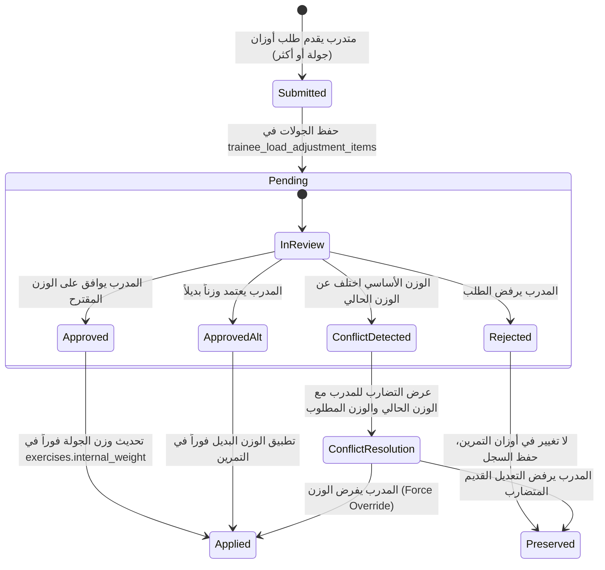

# توثيق نظام تعديل أوزان التمارين للمتدربين والمراجعة المستقلة للجولات (Load Adjustment Specification)

## 1. نظرة عامة والهدف (Overview & Objective)

يهدف هذا التطوير إلى تعزيز وتوسيع آلية طلبات تعديل أوزان التمارين (`Load Adjustment`) التي يرسلها المتدرب إلى المدرب، مع الحفاظ على استقرار النظام وبيانات الإنتاج الحالية:
1. **تحديد الجولات المستهدفة**: تمكين المتدرب من اختيار جولات محددة (Set 1..4) داخل التمرين الواحد واقتراح وزن لكل جولة بشكل مستقل دون المساس بالجولات غير المختارة.
2. **المراجعة المستقلة لكل جولة (Per-Set Review)**: تمكين المدرب من اتخاذ قرار مستقل لكل جولة على حدة (قبول الوزن المقترح، رفض الطلب، أو اعتماد وزن بديل يحدده المدرب) مع إمكانية القبول الجزئي والتطبيق الفوري للوزن المعتمد دون انتظار بقية الجولات.
3. **حماية التضارب وحالات السباق (Conflict Protection)**: منع الكتابة فوق أوزان أحدث تم اعتمادها بواسطة طلبات أخرى سابقة أو متزامنة عن طريق تخزين الوزن الأساسي (`base_weight`) وقت تقديم الطلب ومقارنته مع الوزن الفعلي الحالي في قاعدة البيانات قبل التطبيق.
4. **سجل وتدقيق تاريخي كامل (Historical Audit & Reporting)**: حفظ كافة الطلبات والقرارات دون حذف أو استبدال، مع توفير تقرير تاريخي للمتدرب مفروز حسب اليوم التدريبي (`Workout Day`) وواجهة مركزية شاملة للمدرب داخل الملف التعريفي للمتدرب.

---

## 2. هيكل البيانات والعلاقات (Database Architecture & Models)

### 2.1 تبني الجدول القديم وجدول العناصر الفرعية (Parent-Item Relationship)

تم استخدام نمط الطلب الرئيسي وعناصر الجولات التابعة (`Parent-Item Model`):
- **الجدول الرئيسي (`trainee_load_adjustments`)**: يمثل الطلب الإجمالي للتمارين في جلسة معينة، ويحفظ السياق (`trainee_id`, `exercise_id`, `workout_day_id`, `trainee_notes`, `reported_load`, `status`, `created_at`).
- **الجدول الفرعي (`trainee_load_adjustment_items`)**: جدول جديد تم إنشاؤه عبر المايجريشن الآمنة (`2026_10_24_000001_create_load_adjustments_tables.php`) ليخزن تفاصيل كل جولة مطلوبة بشكل مستقل:
  - `id`: المعرف الفريد لعنصر الجولة.
  - `load_adjustment_id`: معرف الطلب الرئيسي الأب.
  - `set_number`: رقم الجولة (من 1 إلى 4 بحد أقصى).
  - `base_weight`: الوزن الأساسي الفعلي للجولة وقت تقديم الطلب.
  - `suggested_weight`: الوزن الذي اقترحه المتدرب.
  - `approved_weight`: الوزن النهائي الذي اعتمده المدرب (سواء الوزن المقترح أو البديل).
  - `status`: حالة عنصر الجولة (`pending`, `approved`, `rejected`, `conflict`).
  - `coach_notes`: ملاحظات وتوجيهات المدرب للجولة.
  - `reviewed_by`: معرف المدرب الذي قام بالمراجعة.
  - `reviewed_at`: تاريخ ووقت المراجعة.
  - `applied_at`: تاريخ ووقت تطبيق وتحديث الوزن الفعلي في التمرين.
  - `conflict_detected_at`: توقيت اكتشاف التضارب إذا تغير الوزن الأساسي.
  - `conflict_current_weight`: الوزن الحالي الفعلي الذي تم رصده وتسبب في التضارب.

### 2.2 الحفاظ على هيكل تخزين أوزان التمرين (`Exercise::internal_weight`)
- يتم تخزين الأوزان في حقل `exercises.internal_weight` كمصفوفة تسلسلية (JSON/Array) تحتوي على 1 إلى 4 أوزان كحد أقصى تماشيًا مع ثابت `Exercise::MAX_WEIGHTS = 4`.
- تمت إضافة دوال مساعدة في نموذج [Exercise](file:///E:/laragon/www/cap_mahmoud_gym/app/Models/Exercise.php):
  - `getWeightForSet(int $setNumber)`: تجلب الوزن الخاص بالجولة المطلوبة، مع دعم التوافقية العكسية إذا كان الوزن مخزنًا كقيمة مفردة أو مصفوفة.
  - `setWeightForSet(int $setNumber, ?string $weight)`: تعدّل وزن الجولة المستهدفة فقط مع الحفاظ التام على أوزان الجولات الأخرى دون مساس.
  - `getTotalSetsCount()`: تحسب العدد الفعلي للجولات في التمرين بناءً على أوزان الجولات ومصفوفة التكرارات أو حقل `sets`.

---

## 3. دورة حياة الطلب والمراجعة (Request Lifecycle & Workflow)

### 3.1 تقديم الطلب من المتدرب (Trainee Submission)
1. يضغط المتدرب على زر `+` بجانب التمرين المطلوب في لوحة التحكم اليومية.
2. يفتح النموذج السريع المضمن (`Inline Row Form`).
3. يختار المتدرب الجولات المطلوبة من خلال مربعات الاختيار (`Set 1`, `Set 2`... إلخ).
4. يدخل الوزن المقترح لكل جولة تم تحديدها.
5. يكتب ملاحظة توضيحية للمدرب إن رغب.
6. عند الإرسال، تتحقق طبقة الفحص (`LoadAdjustmentReportRequest`) من:
   - أن التمرين يخص جدول المتدرب الحالي.
   - أن أرقام الجولات المرسلة لا تتجاوز عدد الجولات الفعلي في التمرين والحد الأقصى (4).
   - تخزين كل جولة في جدول العناصر مع الاحتفاظ بوزنها الأساسي الحالي (`base_weight`).

### 3.2 المراجعة المستقلة والقبول الجزئي (Independent Coach Review & Partial Approval)
- يمكن للمدرب مراجعة كل جولة على حدة عبر الرابط المستقل:
  `POST /load-adjustment/item/{id}/review`
- خيارات القرار المتاحة لكل جولة:
  1. **الموافقة على المقترح (`approve`)**: اعتماد الوزن المطلوب وتطبيقه مباشرة.
  2. **الرفض (`reject`)**: رفض الجولة دون تغيير الوزن الفعلي في التمرين، مع تسجيل السبب.
  3. **اعتماد وزن بديل (`approve_alternative`)**: إدخال وزن جديد يحدده المدرب (مثل 27.5kg بدلاً من 30kg) وتطبيقه فوراً.
- **القبول الجزئي الفوري**: إذا اشتمل الطلب على 3 جولات، ووافق المدرب على الجولة 1 فقط، يتم تطبيق وزن الجولة 1 فوراً في جدول التمارين وتتحول حالتها إلى `approved`، بينما تظل الجولتان 2 و3 في حالة `pending` مستقلة دون أي تعطيل.

---

## 4. آلية حماية التضارب (Conflict Protection Mechanism)

### المشكلة المعالجة:
إذا طلب المتدرب في يوم الإثنين تعديل وزن الجولة 2 من 25kg إلى 27.5kg (الطلب A).
وقبل أن يراجعه المدرب، طلب المتدرب في يوم الثلاثاء تعديل نفس الجولة إلى 30kg (الطلب B).
إذا اعتمد المدرب الطلب A لاحقاً، ثم راجع الطلب B بعد أسبوع، قد يتم الكتابة فوق الوزن الأحدث دون دراية.

### الحل المطبق:
1. يتم قفل سجل التمرين في قاعدة البيانات فور بدء المراجعة (`lockForUpdate`) داخل معاملة بنكية آمنة (`DB::transaction`).
2. يتم جلب الوزن الفعلي الحالي للجولة في التمرين: `$currentWeight = $exercise->getWeightForSet($item->set_number)`.
3. تتم مقارنة `$currentWeight` مع `$item->base_weight` المسجل وقت تقديم الطلب.
4. **في حال الاختلاف وعدم وجود أمر فرض مسبق (`force`)**:
   - لا يتم تعديل وزن التمرين إطلاقاً.
   - يتم تغيير حالة الجولة إلى `conflict`.
   - يتم تسجيل تاريخ رصد التضارب `conflict_detected_at` والوزن الفعلي الحالي `conflict_current_weight`.
   - يتم إخطار المدرب في الواجهة بوجود تضارب (مثال: "تنبيه تضارب: الوزن الأساسي وقت الطلب كان 20kg بينما الوزن الحالي للتمرين في النظام أصبح 25kg").
5. **حل التضارب الصريح (Explicit Conflict Resolution)**:
   - يتيح النظام للمدرب زرين واضحين:
     - **اعتماد وتجاوز التضارب (`resolve_approve`)**: تطبيق الوزن المطلوب قسراً فوق الوزن الحالي.
     - **رفض التعديل المتضارب (`resolve_reject`)**: إلغاء هذا التعديل القديم وإبقاء الوزن الحالي كما هو.

---

## 5. واجهات وتقارير المستخدم (User Interfaces & Reports)

### 5.1 تقرير المتدرب اليومي (`Trainee Per-Day History`)
- تمت إضافة قسم مخصص أسفل كل يوم تدريبي في لوحة المتدرب:
  `resources/views/system/workout/partials/trainee-load-adjustment-day-history.blade.php`.
- يوضح التقرير كافة الطلبات الخاصة بهذا اليوم، مع بطاقات مستقلة لكل جولة تبين:
  - رقم الجولة والوزن الأساسي.
  - الوزن المطلوب.
  - شارة الحالة الملونة:
    - `قيد المراجعة` (أصفر/تحذيري).
    - `معتمد ومطبق` (أخضر).
    - `مرفوض` (أحمر).
    - `يتطلب تسوية تضارب` (برتقالي).
  - الوزن النهائي المعتمد وملاحظات المدرب وتاريخ المراجعة.

### 5.2 لوحة المدرب المركزية للمراجعة المستقلة (`Coach Review Card`)
- تم تضمين وتحديث كارت المراجعة المستقل في ملف المتدرب:
  `resources/views/system/workout/partials/coach-load-adjustment-sets-card.blade.php`.
- يتيح للمدرب فحص كل طلب وكل جولة، وإدخال ملاحظات أو وزن بديل لكل جولة على حدة، وحل حالات التضارب بضغطة زر دون الحاجة لإعادة تحميل الصفحة بالكامل (عبر AJAX مع مؤشرات تحميل وتنبيهات SweetAlert2 متوافقة مع تصميم النظام).

---

## 6. قواعد الصلاحيات والتحقق (Authorization & Validation)

1. **صلاحيات المتدرب (Trainee Authorization)**:
   - لا يمكن للمتدرب تقديم طلب إلا للتمارين المعينة له شخصياً في جدوله التدريبي النشط.
   - محاولة تقديم طلب لتمرين يخص متدرباً آخر ترجع خطأ منع وصول فوري (`403 Unauthorized`).
   - لا يملك المتدرب أي صلاحية لمراجعة أو قبول أو رفض طلباته أو طلبات غيره.
2. **صلاحيات المدرب (Coach Authorization)**:
   - لا يمكن للمدرب مراجعة طلبات لمتدربين غير معينين له أو ليس لديه تصريح بالوصول لملفاتهم.
3. **التحقق من صحة المدخلات (Data Validation)**:
   - أرقام الجولات يجب أن تكون صحيحة بين 1 و 4 ولا تتجاوز إجمالي جولات التمرين الفعلي.
   - الأوزان المدخلة تخضع لنمط التحقق المعتمد (`string|max:50`).
   - منع تكرار نفس رقم الجولة مرتين في نفس الطلب.
   - عمليات المراجعة متزامنة وآمنة لمنع تكرار المراجعة أو تكرار الإدخال في السجلات.

---

## 7. القيود والبيانات السابقة (Legacy Records & Limitations)

- **الطلبات السابقة للتطوير (Pre-enhancement records)**:
  - الطلبات التاريخية القديمة التي أُنشئت قبل هذا التحديث لا تملك سجلات جولات تفصيلية في `trainee_load_adjustment_items` وإنما تحوي نصاً غير مهيكل في حقل `reported_load`.
  - تم الحفاظ على هذه السجلات بنسبة 100% دون حذف أو تعديل عشوائي؛ ويعرضها النظام بوضوح كـ "طلب أوزان عام (سجل سابق)" دون اختلاق جولات أو قرارات وهمية لم تكن موجودة.
- **حد الجولات الأقصى**:
  - يلتزم النظام التزاماً صارماً بألا يزيد عدد أوزان التمرين عن 4 جولات (`MAX_WEIGHTS = 4`).

---

## 8. ملخص الاختبارات المؤتمتة (Automated Test Suite)

تم إنشاء ملف اختبار شامل ومخصص في:
[tests/Feature/TraineeExerciseLoadUpdateTest.php](file:///E:/laragon/www/cap_mahmoud_gym/tests/Feature/TraineeExerciseLoadUpdateTest.php)

يغطي الملف كافة السيناريوهات العشرين (20) المطلوبة بدقة:
1. `test_trainee_submits_request_for_one_set`: تقديم طلب لجولة واحدة.
2. `test_trainee_submits_request_for_multiple_sets_in_same_exercise`: تقديم طلب لعدة جولات في نفس التمرين.
3. `test_multiple_requests_can_be_submitted_while_earlier_remain_pending`: إمكانية تقديم طلبات جديدة بوجود طلبات سابقة معلقة.
4. `test_requests_cannot_reference_nonexistent_sets`: منع طلب جولات غير موجودة في التمرين.
5. `test_existing_maximum_of_four_sets_is_preserved`: الالتزام بحد أقصى 4 جولات.
6. `test_approving_one_set_changes_only_that_sets_weight`: قبول جولة واحدة يغير وزنها فقط ويحافظ على بقية الجولات.
7. `test_rejecting_a_set_leaves_actual_workout_weight_unchanged`: رفض الجولة لا يغير الوزن في التمرين.
8. `test_approving_an_alternative_coach_selected_weight_applies_alternative`: اعتماد وتطبيق وزن بديل من اختيار المدرب.
9. `test_partially_reviewed_request_retains_independent_states_for_all_remaining_sets`: القبول الجزئي يبقي باقي الجولات معلقة ومستقلة.
10. `test_stale_request_cannot_silently_overwrite_weight_applied_by_another_request`: كشف الطلبات القديمة ومنع الكتابة فوق أوزان أحدث.
11. `test_conflict_detection_preserves_both_requests_and_their_history`: الحفاظ على كلا الطلبين وسجلاتهما عند التضارب.
12. `test_explicit_conflict_resolution_follows_documented_workflow`: حل التضارب الصريح من قبل المدرب وتطبيق التجاوز.
13. `test_trainees_cannot_access_or_modify_other_trainees_requests`: منع المتدربين من التعديل على طلبات غيرهم.
14. `test_unauthorized_coaches_cannot_review_requests`: منع المدربين غير المصرح لهم من المراجعة.
15. `test_coach_side_history_displays_prior_requests_and_decisions`: عرض السجل التاريخي الكامل لقرارات المدرب.
16. `test_trainee_per_day_report_displays_relevant_historical_requests`: عرض تقرير اليوم التدريبي وسجل الجولات للمتدرب.
17. `test_existing_requests_remain_accessible_after_schema_changes`: استمرار الوصول للطلبات القديمة بدون مشاكل.
18. `test_transaction_failures_do_not_leave_partially_applied_weight_update`: التراجع الكامل للعمليات والمعاملات في حال حدوث خطأ.
19. `test_repeated_review_submissions_do_not_duplicate_history`: منع تكرار التطبيق أو تكرار السجلات عند إعادة الإرسال.
20. `test_existing_load_adjustment_behavior_remains_compatible`: استمرار توافق واستقرار آليات التعديل السابقة.
21. `test_comment_author_and_creation_timestamp_displayed_for_trainee_note`: عرض اسم كاتب الملاحظة (المتدرب) وتاريخ ووقت إضافتها بدقة.
22. `test_comment_author_and_creation_timestamp_displayed_for_coach_review_note`: عرض اسم المدرب المراجع وتاريخ ووقت إضافة توجيهاته وملاحظاته.
23. `test_comments_are_attributed_to_actual_authors_not_viewing_user`: التحقق من أن نسبة التعليق تتم للكاتب الفعلي وليس للمستخدم المسجل الحالي الذي يشاهد الصفحة.
24. `test_existing_comments_without_author_metadata_remain_readable_without_errors`: السجلات القديمة بدون بيانات كاتب تظل مقروءة ولا تسبب أي أخطاء برمجية.

**نتيجة التنفيذ**:
- **24 اختبار ناجح من أصل 24 (126 تأكيد Assertion بنجاح 100%)**.
- نجاح كامل لاختبارات منشئ محتوى التمارين والإحماء `WorkoutContentBuilderTest` بنسبة 100% دون أي تعارض.

---

## 9. توثيق آلية كاتب الملاحظة ووقت الإضافة (Comment Author & Timestamp Metadata)

1. **التعرف على كاتب الملاحظة (Author Resolution)**:
   - ملاحظات المتدرب (`trainee_load_adjustments.notes`): يُنسب التعليق إلى المتدرب الفعلي صاحب السجل (`$adj->trainee->name ?? $adj->trainee->user->name`) المستنتج من علاقة `trainee_id`، ولا يتم استنتاجه من المستخدم النشط حالياً في الجلسة.
   - ملاحظات المدرب على الطلب العام أو الجولة الفردية (`coach_notes`): يُنسب التعليق إلى المدرب المراجع الفعلي (`$adj->reviewer->name` أو `$item->reviewer->name`) المرتبط بحقل `reviewed_by`.
2. **وقت وتاريخ الإضافة (Timestamp Resolution)**:
   - لملاحظة المتدرب: يتم الاعتماد على حقل `created_at` الموثق وقت إنشاء الطلب وتنسيقه بالصيغة القياسية المعتمدة في النظام (`Y-m-d H:i`).
   - لملاحظة المدرب: يتم الاعتماد على حقل `reviewed_at` (أو `updated_at` كبديل احتياطي) وتنسيقه بالصيغة (`Y-m-d H:i`).
3. **تسميات الواجهة (Labels)**:
   - يظهر مباشرة بجوار كل تعليق شارة أو نص تعريفي يحوي `Added by: [Author Name]` و `Added at: [Timestamp]` مع دعم الترجمة للنظام (`__('Added by')`, `__('Added at')`).
4. **التوافقية العكسية (Backward Compatibility)**:
   - في السجلات التاريخية القديمة التي قد تخلو من اسم المراجع أو التاريخ، تم استخدام معاملات آمنة من الأخطاء (`null-safe / fallbacks`) لضمان ظهور التعليق دون أي استثناء برمجي أو كسر للواجهات.

