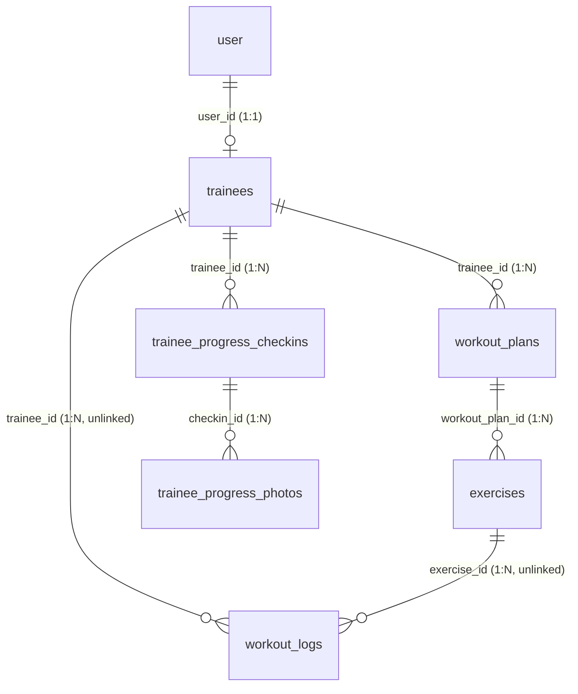
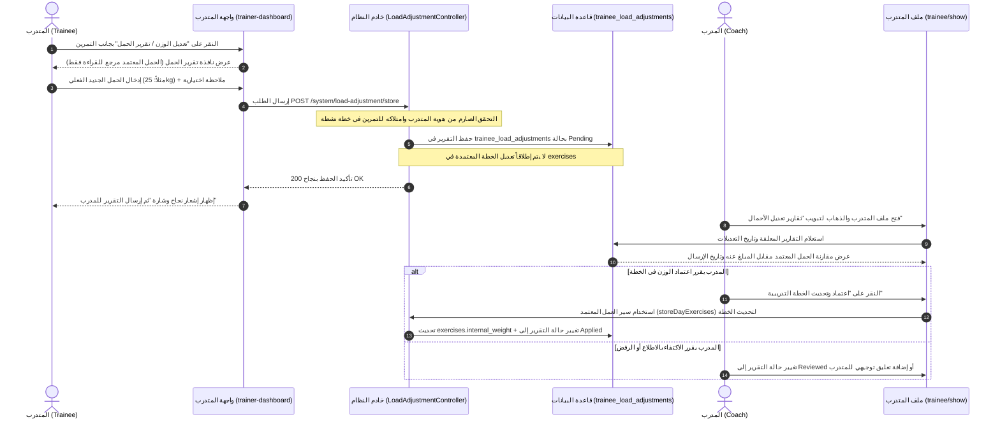

# تقرير التدقيق الفني واستكشاف الشيفرة البرمجية لميزة تعديل الأحمال التدريبية
# (Load Adjustment — Codebase Discovery & Technical Audit)

**المشروع:** نظام إدارة التدريب الرياضي كابتن محمود (Captain Mahmoud Fitness Management System)  
**المسار المستهدف:** `docs/development/load-adjustment-audit.md`  
**تاريخ التدقيق:** أكتوبر 2026  
**الفرع:** `feature/load-adjustment` (مشتق من `refactor-project`)  
**الحالة الفنية:** مكتمل وجاهز للتنفيذ (`READY FOR IMPLEMENTATION`)  

---

## الفهرس العام

1. [المقدمة ونطاق التدقيق الفني](#1-المقدمة-ونطاق-التدقيق-الفني)
2. [هيكلية خطط التمارين الحالية وعلاقات قاعدة البيانات](#2-هيكلية-خطط-التمارين-الحالية-وعلاقات-قاعدة-البيانات)
3. [سير العمل الحالي للمتدرب والمدرب](#3-سير-العمل-الحالي-للمتدرب-والمدرب)
4. [سير العمل المقترح لميزة تعديل الأحمال (Load Adjustment Workflow)](#4-سير-العمل-المقترح-لميزة-تعديل-الأحمال-load-adjustment-workflow)
5. [الفصل الصارم بين الحمل المعتمد والحمل المبلغ عنه](#5-الفصل-الصارم-بين-الحمل-المعتمد-والحمل-المبلغ-عنه)
6. [النموذج البياني المقترح وتقييم الجداول القائمة](#6-النموذج-البياني-المقترح-وتقييم-الجداول-القائمة)
7. [استراتيجية الحفظ التاريخي والتعامل مع التعديل والحذف](#7-استراتيجية-الحفظ-التاريخي-والتعامل-مع-التعديل-والحذف)
8. [التدقيق الأمني وقواعد الصلاحيات والتحقق](#8-التدقيق-الأمني-وقواعد-الصلاحيات-والتحقق)
9. [نقاط التكامل الموصى بها في واجهات المستخدم (UI Integration)](#9-نقاط-التكامل-الموصى-بها-في-واجهات-المستخدم-ui-integration)
10. [مصفوفة الاختبارات المقترحة وتدقيق بيئة الاختبار](#10-مصفوفة-الاختبارات-المقترحة-وتدقيق-بيئة-الاختبار)
11. [المخاطر والأسئلة المعلقة والاعتماديات](#11-المخاطر-والأسئلة-المعلقة-والاعتماديات)
12. [خطة التنفيذ المرحلية (Phased Implementation Plan)](#12-خطة-التنفيذ-المرحلية-phased-implementation-plan)

---

## 1. المقدمة ونطاق التدقيق الفني

تم إعداد هذا التقرير الفني لتدقيق واستكشاف قاعدة البيانات والشيفرة البرمجية تمهيداً لبناء ميزة **تعديل الأحمال التدريبية (Load Adjustment)** في نظام إدارة الجيم.

النظام يعمل حالياً في بيئة الإنتاج (`Production`)؛ لذا فإن معايير السلامة والامتثال غير قابلة للتفاوض:
* لم يتم تنفيذ أي تعديل على منطق الأعمال أو الجداول أو ملفات الترحيل القائمة.
* تم حصر كافة عمليات الفحص والتدقيق في بيئة التطوير المحلية دون الاتصال بقواعد بيانات الإنتاج.
* كافة الاختبارات نُفّذت حصراً عبر بيئة `SQLite :memory:` كما هو محدد في ملف [phpunit.xml](file:///e:/laragon/www/cap_mahmoud_gym/phpunit.xml).
* تم الحفاظ الكامل على كافة الملفات وسجلات التعديل التاريخية.

---

## 2. هيكلية خطط التمارين الحالية وعلاقات قاعدة البيانات

من خلال فحص نماذج الكيانات والعلاقات الفردية وتتبع مسار الطلبات حتى قاعدة البيانات، تم رصد الهيكلية التالية:



### أ. المستخدم والمتدرب (Separation of `user.id` and `trainees.id`)
* **جدول المستخدمين (`user`):** يمثل كيان المصادقة الأساسي (`Authentication Principal`) برقم التعريف `user.id`. يحتوي على الحقول: `id`, `name`, `email`, `password`, `user_type`, `status`, `permission_group_id`.
  - `user_type = 1`: مشرف / مدرب ذو صلاحيات إدارية كاملة (`Admin / Coach`).
  - `user_type = 2`: مدرب بدون صلاحيات أو متدرب (`Trainer without permission / Trainee`).
  - `user_type = 3`: متدرب رياضي (`Trainee`).
* **جدول المتدربين (`trainees`):** يمثل الملف الشخصي والرياضي للمتدرب برقم التعريف المستقل `trainees.id`. يحتوي على: `id`, `user_id`, `name`, `email`, `age`, `weight` (الوزن البدني بالكيلوجرام), `height`, `membership_start`, `membership_end`, `training_level`, `status`.
* **قاعدة معمارية هامة:** `trainees.id` يختلف تماماً عن `user.id`. في كافة استعلامات التمارين والخطط، يجب الربط حصراً بـ `trainees.id` بعد استخراجه عبر الحساب المصادق `Auth::guard('user')->user()`. تم توفير الدالة المساعدة [resolveTraineeAndUser()](file:///e:/laragon/www/cap_mahmoud_gym/app/Services/TraineeService.php#L39) لفك التشفير وحل التعارض بين المعرفين.

### ب. خطط التمارين والأيام (`workout_plans`)
* النموذج [WorkoutPlan](file:///e:/laragon/www/cap_mahmoud_gym/app/Models/WorkoutPlan.php) يمثل في واقع الأمر **يوماً تدريبياً واحداً** (مثل: "Day 1 - Chest", "Upper Body", "Legs") وليس كراسة تمارين مجمعة.
* الحقول الرئيسية: `id`, `trainee_id`, `day_name`, `warmup`, `warmup_links` (JSON Array بحد أقصى 5 روابط), `post_workout`, `status` (`active`, `inactive`, `archived`), `deleted_at`.
* الحالة النشطة/المعطلة: يتم التعامل مع حالة `inactive` عبر بادئة `[INACTIVE]` في حقل `day_name` بواسطة الـ Mutators/Accessors، في حين تُحفظ البرامج السابقة كـ `archived` مع تجميع الأيام المؤرشفة ضمن نافذة زمنية 120 ثانية عبر الخاصية `archivedProgramBatches`.

### ج. التمارين والأوزان المقررة (`exercises`)
* النموذج [Exercise](file:///e:/laragon/www/cap_mahmoud_gym/app/Models/Exercise.php) يتبع يوماً تدريبياً محدداً عبر `workout_plan_id`.
* الحقول:
  - `id`: المعرف الفريد للتمرين.
  - `workout_plan_id`: معرف اليوم التدريبي.
  - `type`: تصنيف التمرين (`warmup` إحماء, `main` برنامج رئيسي, `post_workout` تبريد واستشفاء).
  - `name`: اسم التمرين (مثل "Barbell Bench Press").
  - `sets`: عدد الجولات المقررة (Integer).
  - `reps`: التكرارات المقررة (String, مثل "8-10").
  - `rest`: وقت الراحة بالثواني (String).
  - `internal_weight`: **الحمل / الوزن المعتمد المقرر من المدرب**.
  - `tempo`: إيقاع الحركة (String).
  - `link`: رابط الفيديو الإرشادي (YouTube / Google Drive مع دوال توليد الروابط المضمنة).
  - `notes_en`: ملاحظات فنية وتوجيهية من المدرب.
  - `machine_image`: مسار صورة الجهاز الرياضي.
  - `deleted_at`: دعم الحذف الناعم (`SoftDeletes`).

### د. كيفية تخزين وتعديل الأوزان المقررة حالياً
* يُخزن الحقل `internal_weight` في عمود `varchar(100)` في جدول `exercises`.
* يدعم النظام مصفوفة أوزان متعددة بحد أقصى 4 قيم (`MAX_WEIGHTS = 4`) عبر Eloquent Attribute Cast:
  - عند الإدخال: تقبل الدالة `normalizeWeights()` مصفوفة أو نصاً مجزءاً أو نصاً قديماً (مثل `"20kg"` أو `["10kg", "15kg"]`) وتخزنها كـ `JSON` مشفر.
  - عند القراءة: تعيد الدالة مصفوفة نظيفة دائماً `['10kg', '15kg']`.
  - للعرض: يوفر النموذج الخاصية `internal_weight_display` التي تعيد الأوزان مفصولة بشرطة مائلة (مثل: `"10kg / 15kg"`).

---

## 3. سير العمل الحالي للمتدرب والمدرب

### أ. سير عمل المتدرب (Trainee Workflow)
1. يسجل المتدرب الدخول عبر الحراسة `Auth::guard('user')`.
2. وسيط الصلاحيات [Permission.php](file:///e:/laragon/www/cap_mahmoud_gym/app/Http/Middleware/Permission.php#L30) يتحقق من نوع الحساب (`user_type` 2 أو 3) ويقيد وصوله إلى قائمة بيضاء محددة (`whitelist`)، مع توجيهه التلقائي لمسار لوحة التحكم الرياضية `system.dashboard.trainer`.
3. يتولى المتحكم [Dashboard@trainerDashboard](file:///e:/laragon/www/cap_mahmoud_gym/app/Modules/System/Dashboard.php#L124) جلب بيانات المتدرب عبر [TraineeService@getTraineeFirst](file:///e:/laragon/www/cap_mahmoud_gym/app/Services/TraineeService.php) وجلب الخطط النشطة عبر [WorkoutRepository@getExcercisesByTrainee](file:///e:/laragon/www/cap_mahmoud_gym/app/Repositories/Workout/WorkoutRepository.php#L135).
4. تُعرض الصفحة عبر القالب [resources/views/system/trainer-dashboard.blade.php](file:///e:/laragon/www/cap_mahmoud_gym/resources/views/system/trainer-dashboard.blade.php):
   - يظهر شريط تبويبات للأيام التدريبية النشطة (`Day Tabs`).
   - داخل كل يوم، تُعرض جداول لتمارين الإحماء والبرنامج الرئيسي وتمارين ما بعد التمرين.
   - يعرض الجدول عمود الوزن (`Weight`) بقيمة للقراءة فقط من خلال الشارة `badge-weight` عبر `$exercise->internal_weight_display`.
   - **الوضع الحالي:** لا يوجد أي زر أو نموذج أو مسار برمجي يتيح للمتدرب حالياً الإبلاغ عن تعديل حمله التدريبي أو إرسال تقرير للأوزان التي يرفعها بالفعل.

### ب. سير عمل المدرب (Coach / Admin Workflow)
1. يستعرض المدرب المتدربين عبر المتحكم [TraineeController](file:///e:/laragon/www/cap_mahmoud_gym/app/Modules/System/TraineeController.php).
2. عند فتح ملف المتدرب [trainee/show.blade.php](file:///e:/laragon/www/cap_mahmoud_gym/resources/views/system/trainee/show.blade.php)، يستعرض التبويبات الخمسة:
   - `Workout Program` (خطط التمارين الحالية والأيام المؤرشفة وإمكانية إضافة وتعديل الأيام).
   - `Nutrition Plan` (الخطط الغذائية).
   - `Progress & Photos` (تسجيلات الوزن البدني وصور التقدم).
   - `History (Audit Log)` (سجل النشاطات عبر Spatie Activitylog).
   - `Auth Sessions` (جلسات الدخول النشطة).
3. عند رغبة المدرب في تعديل الخطة، يرسل طلباً عبر `POST /system/workout/day/{dayId}/update` الذي يستقبله [WorkoutController@storeDayExercises](file:///e:/laragon/www/cap_mahmoud_gym/app/Modules/System/WorkoutController.php#L63).
4. تقوم الدالة [WorkoutRepository@syncDayExercises](file:///e:/laragon/www/cap_mahmoud_gym/app/Repositories/Workout/WorkoutRepository.php#L21) بمزامنة مصفوفة التمارين:
   - التمارين الحالية يتم تحديث بياناتها وتحديث `internal_weight`.
   - التمارين المحذوفة من النموذج يتم حذفها ناعماً (`Soft Delete`).
   - التمارين الجديدة يتم إنشاؤها وربطها باليوم التدريبي.

---

## 4. سير العمل المقترح لميزة تعديل الأحمال (Load Adjustment Workflow)



### خطوات سير العمل بالتفصيل:

1. **تقديم التقرير بواسطة المتدرب:**
   - يظهر زر بجانب كل تمرين في لوحة المتدرب `[Report Load / تقرير الحمل]`.
   - يفتح المتدرب نافذة تفاعلية (`Modal`) تعرض:
     - اسم التمرين واليوم التدريبي.
     - الحمل المعتمد حالياً من المدرب (للقراءة فقط، مثل `"20kg"`).
     - حقل إدخال الحمل الجديد الفعلي (مثل `"25kg"`).
     - حقل نصي اختياري لملاحظة المتدرب (مثل `"تم إكمال 10 تكرارات بسهولة في الجولتين الأخيرتين"`).
   - عند الإرسال، يُحفظ سجل تاريخي في جدول مخصص `trainee_load_adjustments` مع الحفاظ التام على هوية المتدرب، التمرين، اليوم، الحمل المعتمد وقت الإرسال، الحمل الجديد، والوقت الدقيق.

2. **عرض التقارير للمدرب:**
   - يُضاف تبويب مخصص في صفحة المتدرب [trainee/show.blade.php](file:///e:/laragon/www/cap_mahmoud_gym/resources/views/system/trainee/show.blade.php) بعنوان `Load Adjustments / تقارير تعديل الأحمال` مع شارة بعدد التقارير المعلقة (`Pending Badge`).
   - كذلك تظهر علامة تنبيهية صغيرة بجانب التمرين في جدول الخطة تشير إلى وجود تقرير حمل جديد مقدم من المتدرب.
   - يعرض التبويب جدولاً تاريخياً يتضمن:
     - تاريخ ووقت التقديم.
     - اليوم التدريبي والتمرين.
     - الحمل المعتمد في الخطة (Prescribed Load) مقابل الحمل الذي رفعه المتدرب (Reported Load).
     - ملاحظة المتدرب.
     - حالة المراجعة (`Pending`, `Reviewed`, `Applied`).
     - خيارات التفاعل المتاحة للمدرب.

3. **قرار المدرب وسير التعديل المعتمد:**
   - يراجع المدرب التقرير بشكل مستقل.
   - إذا رأى المدرب أن زيادة الحمل ملائمة، يتخذ إجراء تعديل الخطة عبر سير عمل تعديل الخطة المعتمد والمصرح له [WorkoutRepository@syncDayExercises](file:///e:/laragon/www/cap_mahmoud_gym/app/Repositories/Workout/WorkoutRepository.php#L21).
   - لا يتم اختراع مسار جانبي سري يتجاوز ضوابط الصلاحيات؛ بل يتم توجيه المدرب إلى محرر اليوم التدريبي مع زر تعبئة سريعة للقيمة المقترحة، أو زر "تطبيق في الخطة" تحت صلاحيات المدرب المباشرة.

---

## 5. الفصل الصارم بين الحمل المعتمد والحمل المبلغ عنه

هذا المبدأ يمثل الركيزة الجوهرية لمنظومة التدريب الرياضي الاحترافية:

| المعيار | الحمل المعتمد المقبول (Prescribed Load) | الحمل المبلغ عنه من المتدرب (Reported Load) |
| :--- | :--- | :--- |
| **الموقع في قاعدة البيانات** | عمود `internal_weight` في جدول `exercises` | عمود `reported_load` في جدول `trainee_load_adjustments` |
| **صاحب الصلاحية في التعديل** | **المدرب المعتمد فقط** (`Coach / Admin`) | **المتدرب فقط** (`Trainee`) للتمرين المصرح له به |
| **طبيعة البيانات** | وصفة تدريبية ملزمة توجّه المتدرب في الجيم | معلومة تغذية راجعة (`Feedback / Signal`) تصف ما تم رفعه فعلياً |
| **التأثير على الخطة** | يحدد ما يظهر في شارة الوزن المعتمدة بالخطة | **لا يغير الخطة إطلاقاً** ولا يؤثر على إرشادات التمرين الأصلية |
| **السلوك عند الحفظ** | يُعدل السجل المباشر للتمرين عبر `syncDayExercises` | ينشئ **سجلاً تاريخياً جديداً** غير قابل للتعديل بالمسح |

> [!CRITICAL]
> **القاعدة الحاكمة:** تقديم المتدرب لتقرير تعديل حمل تدريبي هو إجراء استعلامي وإخباري للمدرب (`Informational Report`)، وليس أمراً برمجياً يملك صلاحية الكتابة فوق الخطة المعتمدة (`Plan Overwrite`).

---

## 6. النموذج البياني المقترح وتقييم الجداول القائمة

### أ. تقييم إمكانية إعادة استخدام الجداول الحالية
تم فحص الجداول الموجودة في المخطط البياني للنظام:

1. **جدول سجلات التمرين (`workout_logs`):**
   - **الواقع البرمجي:** الجدول موجود في الترحيل التأسيسي [2026_09_29_000000_create_baseline_schema.php](file:///e:/laragon/www/cap_mahmoud_gym/database/migrations/2026_09_29_000000_create_baseline_schema.php#L145)، ولكنه **غير مستخدم نهائياً** في منطق التطبيق (لا يوجد له نموذج Eloquent، ولا متحكم، ولا مسارات، ولا واجهات).
   - **القصور الهيكلي:** هيكل الجدول مبني على أساس تسجيل الجولات الفردية (`set_number`, `reps_completed`, `weight_lifted`, `performed_at`).
   - **العائق الأمني والتاريخي الخطير:** يحتوي الجدول على قيد مرجعي مباشر `ON DELETE CASCADE` على `exercises.id`. عند قيام المدرب بحذف تمرين أو إعادة مزامنة تمارين اليوم عبر محرر الخطط، يتم حذف التمرين مما يتسبب بحذف كافة سجلات `workout_logs` المرتبطة به تلقائياً فيزيائياً وفقدان السجل التاريخي بالكامل!
   - **النتيجة:** غير ملائم لميزة تقارير تعديل الأحمال بدون تشويه معناه أو إتلاف بياناته المستقبلية.

2. **جدول متابعة التقدم والأوزان البدنية (`trainee_progress_checkins`):**
   - مخصص حصراً لتسجيل وزن الجسم (`body weight`) وصور القياسات التطورية الدورية.
   - حقل الوزن فيه رقمي بدقة خانتين عشريتين (`decimal(5,2)`) يعبر عن وزن المتدرب بالكيلوجرام (مثل 84.50 kg).
   - لا يرتبط بتمارين أو أيام أو خطط.
   - **النتيجة:** غير ملائم على الإطلاق لتقارير أوزان التمارين.

### ب. جدول البيانات المستقل الموصى به: `trainee_load_adjustments`

يوصى بإنشاء جدول جديد مخصص باسم `trainee_load_adjustments` عبر ترحيلة أمامية آمنة (`Forward Migration`)، مع الهيكل التالي:

```sql
CREATE TABLE `trainee_load_adjustments` (
    `id` BIGINT UNSIGNED NOT NULL AUTO_INCREMENT PRIMARY KEY,
    `trainee_id` BIGINT UNSIGNED NOT NULL,
    `workout_plan_id` BIGINT UNSIGNED NULL,
    `exercise_id` BIGINT UNSIGNED NULL,
    
    -- لقطات تاريخية ثابتة لحماية البيانات عند حذف أو تعديل التمرين مستقبلاً
    `workout_day_name` VARCHAR(100) NOT NULL,
    `exercise_name` VARCHAR(150) NOT NULL,
    `prescribed_load` VARCHAR(100) NULL,
    
    -- بيانات التقرير المقدمة من المتدرب
    `reported_load` VARCHAR(100) NOT NULL,
    `notes` TEXT NULL,
    
    -- بيانات مراجعة المدرب والتدقيق
    `status` ENUM('pending', 'reviewed', 'applied', 'dismissed') NOT NULL DEFAULT 'pending',
    `coach_notes` TEXT NULL,
    `reviewed_by` BIGINT UNSIGNED NULL,
    `reviewed_at` TIMESTAMP NULL,
    
    `created_at` TIMESTAMP NULL DEFAULT CURRENT_TIMESTAMP,
    `updated_at` TIMESTAMP NULL DEFAULT CURRENT_TIMESTAMP ON UPDATE CURRENT_TIMESTAMP,
    `deleted_at` TIMESTAMP NULL,
    
    INDEX `idx_load_adj_trainee_status` (`trainee_id`, `status`),
    INDEX `idx_load_adj_exercise` (`exercise_id`),
    INDEX `idx_load_adj_created_at` (`created_at`),
    
    CONSTRAINT `fk_load_adj_trainee` FOREIGN KEY (`trainee_id`) 
        REFERENCES `trainees` (`id`) ON DELETE CASCADE,
    CONSTRAINT `fk_load_adj_plan` FOREIGN KEY (`workout_plan_id`) 
        REFERENCES `workout_plans` (`id`) ON DELETE SET NULL,
    CONSTRAINT `fk_load_adj_exercise` FOREIGN KEY (`exercise_id`) 
        REFERENCES `exercises` (`id`) ON DELETE SET NULL,
    CONSTRAINT `fk_load_adj_coach` FOREIGN KEY (`reviewed_by`) 
        REFERENCES `user` (`id`) ON DELETE SET NULL
) ENGINE=InnoDB DEFAULT CHARSET=utf8mb4 COLLATE=utf8mb4_unicode_ci;
```

---

## 7. استراتيجية الحفظ التاريخي والتعامل مع التعديل والحذف

### أ. تراكم السجلات ومنع الكتابة فوق القديم (Immutable History)
* كل تقرير يرسله المتدرب يولد صفاً جديداً تماماً في جدول `trainee_load_adjustments`.
* إذا أرسل المتدرب تقريراً لتمرين البنش برس اليوم بوزن 20 كجم، ثم أرسل بعد أسبوع تقريراً لنفس التمرين بوزن 25 كجم، يظل التقريران متاحين للمدرب في خط زمني تطوري يوضح تسلسل الزيادة عبر الزمن.

### ب. استراتيجية الحفاظ على البيانات عند حذف أو أرشفة أو استبدال التمارين والخطط
1. **استخدام لقطات البيانات الثابتة (Context Snapshots):**
   - عند إنشاء السجل، يتم نسخ `exercise_name` و `workout_day_name` و `prescribed_load` كقيم نصية في سجل التقرير.
   - حتى لو قام المدرب لاحقاً بإعادة تسمية التمرين أو حذفه أو استبدال اليوم، تظل بطاقة التقرير محتفظة بهويتها ومعناها الكامل (مثال: "تمرين Barbell Bench Press ضمن يوم Chest Day — الحمل المعتمد وقتها كان 15kg وأبلغ المتدرب عن 20kg في 21 أكتوبر 2026").
2. **سياسة المفاتيح الأجنبية الآمنة (`ON DELETE SET NULL`):**
   - حقول `exercise_id` و `workout_plan_id` تقبل القيمة الفارغة (`NULL`).
   - عند حذف التمرين من جدول `exercises` (سواء بالحذف الناعم أو النهائي)، لا يتم حذف تقرير تعديل الحمل التابع له إطلاقاً، بل يتحول المفتاح الأجنبي إلى `NULL` بينما تبقى أعمدة اللقطة النصية `exercise_name` شاهدة على ماهية التمرين وتاريخه.
3. **أرشفة الخطط (`Archived Workout Plans`):**
   - عند قيام المدرب بإعادة تعيين خطة المتدرب عبر [TraineeController@resetPlan](file:///e:/laragon/www/cap_mahmoud_gym/app/Modules/System/TraineeController.php#L150)، يتم تحويل حالة الأيام السابقة إلى `archived`.
   - لا تتأثر تقارير تعديل الأحمال بذلك، وتظل مرتبطة تاريخياً بملف المتدرب ومتاحة للمراجعة والتحليل المقارن.

---

## 8. التدقيق الأمني وقواعد الصلاحيات والتحقق

### أ. تحديد الهوية والمصادقة (`Authentication & Identity`)
* المتدرب يسجل الدخول بحراسة `Auth::guard('user')`.
* يتم استخراج سجل المتدرب برمجياً في جانب الخادم عبر:
  ```php
  $authUser = Auth::guard('user')->user();
  $trainee = Trainee::where('user_id', $authUser->id)->firstOrFail();
  ```
* **حظر التزوير المباشر (IDOR Prevention):** لا يُسمح للعميل بتمرير `trainee_id` في الطلب؛ وإن وُجد في الطلب يتم تجاهله تماماً أو رفضه في حال عدم مطابقته لـ `$trainee->id`.

### ب. التحقق الصارم من ملكية التمرين والخطة النشطة (`Exercise Ownership Validation`)
* لمنع متدرب من تقديم تقرير لتمرين لا ينتمي لخطته أو ينتمي لمتدرب آخر، يجب تطبيق فحص الصلاحية الإلزامي التالي في الخدمة / المتحكم:
  ```php
  $exercise = Exercise::with('workoutPlan')->findOrFail($request->exercise_id);
  
  // التحقق من أن التمرين ينتمي لخطة المتدرب المصادق
  if (!$exercise->workoutPlan || (int) $exercise->workoutPlan->trainee_id !== (int) $trainee->id) {
      abort(403, __('Unauthorized exercise report submission.'));
  }
  
  // التحقق من أن الخطة التدريبية ما زالت نشطة وليست مؤرشفة
  if ($exercise->workoutPlan->status === 'archived') {
      abort(422, __('Cannot submit load adjustment for an archived workout program.'));
  }
  ```

### ج. تحديث وسيط الصلاحيات (`Permission Middleware`) والقائمة البيضاء
* نظراً لأن وسيط [Permission.php](file:///e:/laragon/www/cap_mahmoud_gym/app/Http/Middleware/Permission.php#L31) يعيد توجيه المتدربين (`user_type` 2 أو 3) إلى `system.dashboard.trainer` لأي مسار خارج القائمة البيضاء، فإنه **يجب تضمين مسار التقديم الجديد**:
  - في `$whitelist` داخل [app/Http/Middleware/Permission.php](file:///e:/laragon/www/cap_mahmoud_gym/app/Http/Middleware/Permission.php#L31).
  - في مصفوفة المسارات المستثناة `ignoredRoutes()` داخل [app/Helpers/Global.helpers.php](file:///e:/laragon/www/cap_mahmoud_gym/app/Helpers/Global.helpers.php#L104).
* المسارات الإدارية الخاصة بمراجعة المدرب للتقارير وتحديث حالتها تقتصر على مستخدمي النظام الإداريين (`user_type = 1`) مع حظر تام للمتدربين من استدعائها (`403 Forbidden`).

### د. قواعد التحقق في الطلب (`Form Request Validation Rules`)
إنشاء طلب مخصص `LoadAdjustmentRequest` يفرض القواعد التالية:
* `exercise_id`: `required|integer|exists:exercises,id`
* `reported_load`: `required|string|max:100` (مع تنظيف المدخلات من وسوم HTML ونصوص التخريب `strip_tags()`)
* `notes`: `nullable|string|max:1000`

---

## 9. نقاط التكامل الموصى بها في واجهات المستخدم (UI Integration)

### أ. لوحة تحكم المتدرب ([trainer-dashboard.blade.php](file:///e:/laragon/www/cap_mahmoud_gym/resources/views/system/trainer-dashboard.blade.php))
1. **عمود الأوزان وجدول التمارين:**
   - بجانب شارة الوزن الحالية `badge-weight`، يُضاف زر أنيق أو أيقونة تفاعلية سريعة `[تعديل الوزن / الإبلاغ عن حمل جديد]` برمز `fas fa-weight-hanging` أو `fas fa-sliders-h`.
2. **النافذة التفاعلية لتقديم التقرير (`Load Adjustment Modal`):**
   - تصميم متناسق مع النمط الجمالي الداكن (`Dark Aesthetic & Glassmorphism`) للوحة المتدرب.
   - يعرض بطاقة التمرين، الحمل المعتمد للقراءة فقط، حقل إدخال الحمل الجديد مع أزرار زيادة/نقصان سريعة أو خيارات شائعة، وحقل ملاحظة اختياري للمدرب.
   - إرسال عبر AJAX مع مؤشر تحميل وردود فعل فورية (`SweetAlert2 / Toastr`) دون إعادة تحميل الصفحة.
3. **تبويب / شريط جانبي لسجل تقارير المتدرب (`My Load Reports`):**
   - يتيح للمتدرب رؤية تقاريره السابقة وحالة مراجعتها من المدرب.

### ب. ملف المتدرب الإداري للمدرب ([trainee/show.blade.php](file:///e:/laragon/www/cap_mahmoud_gym/resources/views/system/trainee/show.blade.php))
1. **تبويب رئيسي جديد:**
   - إضافة تبويب سادس في قائمة التبويبات الرئيسية `gym-trendy-tabs` بجانب `Workout Program` و `Nutrition Plan`:
     `<a class="nav-link" data-bs-toggle="tab" href="#kt_load_adjustments_tab"><span>⚖️</span> <span>Load Adjustments</span> <span class="badge badge-circle badge-danger ms-2">3</span></a>`
2. **جدول استعراض التقارير:**
   - جدول أنيق يوضح اليوم التدريبي، التمرين، الحمل المعتمد في الخطة، الحمل الجديد المبلغ عنه مع شارة مقارنة ملونة (`Diff Badge`)، وملاحظة المتدرب، وزر مراجعة.
3. **التكامل مع محرر الخطة التدريبية:**
   - تزويد المدرب بزر إجراء سريع `[تطبيق في الخطة / Apply to Plan]` يفتح محرر اليوم التدريبي المعني مع تعبئة الوزن الجديد تلقائياً، ليقوم المدرب بحفظه عبر المسار المعتمد رسمياً `storeDayExercises`.

---

## 10. مصفوفة الاختبارات المقترحة وتدقيق بيئة الاختبار

### أ. تدقيق بيئة الاختبار الحالية (`Test Suite & Environment Audit`)
* تم فحص ملف الإعداد [phpunit.xml](file:///e:/laragon/www/cap_mahmoud_gym/phpunit.xml) والتأكد من الضوابط التالية:
  - `DB_CONNECTION = sqlite` (إجباري).
  - `DB_DATABASE = :memory:` (إجباري).
  - `APP_ENV = testing` (إجباري).
* تم تشغيل كافة اختبارات النظام القائمة في مسار `tests/Feature/` وجاءت النتائج كالتالي:

| فئة الاختبار | عدد الاختبارات | عدد التأكيدات | النتيجة الفعلية |
| :--- | :---: | :---: | :---: |
| [ExampleTest.php](file:///e:/laragon/www/cap_mahmoud_gym/tests/Feature/ExampleTest.php) | 3 | 13 | **PASSED** |
| [DatabaseSchemaConsistencyTest.php](file:///e:/laragon/www/cap_mahmoud_gym/tests/Feature/DatabaseSchemaConsistencyTest.php) | 7 | 85 | **PASSED** |
| [TraineeWorkflowIntegrationTest.php](file:///e:/laragon/www/cap_mahmoud_gym/tests/Feature/TraineeWorkflowIntegrationTest.php) | 12 | 70 | **PASSED** |
| [TraineeProgressAuthorizationTest.php](file:///e:/laragon/www/cap_mahmoud_gym/tests/Feature/TraineeProgressAuthorizationTest.php) | 17 | 78 | **PASSED** |
| [TraineeManagementTest.php](file:///e:/laragon/www/cap_mahmoud_gym/tests/Feature/TraineeManagementTest.php) | 13 | 72 | **PASSED** |
| [SystemAuthorizationSecurityTest.php](file:///e:/laragon/www/cap_mahmoud_gym/tests/Feature/SystemAuthorizationSecurityTest.php) | 12 | 75 | **PASSED** |
| [PrivateFileSecurityAndAdminWorkflowTest.php](file:///e:/laragon/www/cap_mahmoud_gym/tests/Feature/PrivateFileSecurityAndAdminWorkflowTest.php) | 17 | 69 | **PASSED** |
| [CodeQualityPerformanceTest.php](file:///e:/laragon/www/cap_mahmoud_gym/tests/Feature/CodeQualityPerformanceTest.php) | 4 | 33 | **PASSED** |
| **الإجمالي** | **85 اختباراً** | **495 تأكيداً** | **100% ناجح دون أي فشل** |

### ب. حالات الاختبار المقترحة لميزة تعديل الأحمال (Load Adjustment Test Cases)
يجب بناء فئة اختبارات مخصصة `tests/Feature/LoadAdjustmentTest.php` تغطي السيناريوهات التالية:

1. `test_trainee_can_submit_valid_load_adjustment_report()`:
   - التأكد من قدرة المتدرب المصادق على إرسال تقرير حمل سليم لتمرين مصرح له به والحصول على كود 200/201.
2. `test_submission_does_not_modify_prescribed_workout_plan_or_exercise_weights()`:
   - التأكد الصارم من بقاء قيمة `exercises.internal_weight` دون أي تغيير بعد إرسال التقرير، وتطابق الخطة المعتمدة تماماً كما كانت.
3. `test_trainee_cannot_submit_report_for_another_trainee_idor_prevention()`:
   - محاولة المتدرب إرسال تقرير يتضمن معرف متدرب آخر، والتأكد من رفض الطلب أو ربطه حصراً بالمتدرب المصادق.
4. `test_trainee_cannot_submit_report_for_exercise_belonging_to_another_trainee()`:
   - محاولة متدرب إرسال تقرير لتمرين مسجل لمتدرب آخر، والتحقق من رمي استثناء `403 Forbidden`.
5. `test_trainee_cannot_submit_report_for_archived_workout_plan()`:
   - محاولة إرسال تقرير لتمرين يتبع يوماً تدريبياً مؤرشفاً، والتحقق من رفض الطلب برمز `422 Unprocessable Entity`.
6. `test_validation_rejects_missing_or_invalid_load_inputs()`:
   - إرسال نصوص فارغة أو تفوق 100 حرف، والتحقق من أخطاء التحقق القياسية `ValidationErrors`.
7. `test_multiple_submissions_preserve_complete_history_without_overwriting()`:
   - إرسال تقريرين متتاليين لنفس التمرين، والتأكد من حفظ سجلين منفصلين وبقاء السجل الأول بكامل تفاصيله.
8. `test_coach_can_view_and_review_trainee_load_adjustment_history()`:
   - تسجيل الدخول كمدرب وعرض تقارير المتدرب والتأكد من ظهور كافة البيانات وتطابق شارات المقارنة.
9. `test_unauthorized_guests_and_trainees_blocked_from_coach_review_endpoints()`:
   - التأكد من حظر الضيوف والمتدربين من استدعاء مسارات المراجعة الإدارية.
10. `test_exercise_deletion_preserves_load_adjustment_history_via_snapshots()`:
    - حذف تمرين ناعماً أو فيزيائياً، والتأكد من بقاء سجل تعديل الحمل التاريخي مع احتفاظه بلقطة الاسم واليوم والحمل المعتمد.
11. `test_coach_plan_update_workflow_remains_independent_from_report_submission()`:
    - التحقق من أن قيام المدرب بتحديث الخطة المعتمدة هو إجراء منفصل يخضع لسير العمل الإداري المصرح.

---

## 11. المخاطر والأسئلة المعلقة والاعتماديات

### أ. المخاطر التقنية (Technical Risks)
1. **تعدد صيغ الوزن في عمود `internal_weight`:**
   - الحقل الحالي في `exercises` يخزن أحياناً مصفوفة JSON مشفرة (مثل `["10kg","15kg"]`) وأحياناً نصوصاً قديمة (مثل `"20kg"`).
   - *الإجراء الوقائي:* يجب استخدام دوال النموذج `Exercise::normalizeWeights()` والخاصية `internal_weight_display` لضمان قراءة القيمة المرجعية بصيغة نصية واضحة وموحدة قبل تخزينها في لقطة التقرير.
2. **مخاطر ترحيلات قاعدة البيانات في بيئة الإنتاج:**
   - لا يجوز تشغيل أي ترحيلة تعتمد على حذف أعمدة أو جداول قائمة (`Destructive Migrations`).
   - *الإجراء الوقائي:* يجب أن تكون الترحيلة للأمام فقط (`Forward-only`) مع استخدام الشروط الآمنة `if (!Schema::hasTable(...))`.
3. **حجم واجهة الاستخدام على الأجهزة المحمولة (`Mobile Responsiveness`):**
   - المتدربون يستخدمون هواتفهم أثناء التواجد في صالة الجيم لتسجيل الأوزان؛ لذا يجب أن تكون نافذة التقرير مهيأة تماماً للمس وشاشات الهواتف الذكية.

### ب. الاعتماديات (Dependencies)
* الاعتماد الكامل على استقرار جدول `trainees` و `workout_plans` و `exercises`.
* عدم وجود نظام إشعارات لحظية (`WebSockets / Real-time Notifications`) في المشروع حالياً؛ لذا سيتم الاعتماد على شارات العد الإحصائية (`Badge Counters`) في التبويبات ولوحة التحكم لحين تطوير نظام إشعارات شامل.

---

## 12. خطة التنفيذ المرحلية (Phased Implementation Plan)

```
┌────────────────────────────────────────────────────────────────────────┐
│                        خطة التنفيذ المرحلية المقترحة                     │
├───────────────────┬────────────────────────────────────────────────────┤
│ المرحلة 1         │ إنشاء ترحيلة قاعدة البيانات الآمنة ونموذج Eloquent  │
│ Phase 1           │ Migration: trainee_load_adjustments + Model        │
├───────────────────┼────────────────────────────────────────────────────┤
│ المرحلة 2         │ بناء المتحكم وخدمة معالجة التقارير وقواعد الصلاحيات │
│ Phase 2           │ LoadAdjustmentController + Service + FormRequest   │
├───────────────────┼────────────────────────────────────────────────────┤
│ المرحلة 3         │ بناء واجهة المتدرب (Modal + شارات تفاعلية)         │
│ Phase 3           │ Trainee UI: Modal & AJAX in trainer-dashboard      │
├───────────────────┼────────────────────────────────────────────────────┤
│ المرحلة 4         │ بناء واجهة المدرب (تبويب التقارير وربط محرر الخطة) │
│ Phase 4           │ Coach UI: Tab in trainee/show & Plan sync link     │
├───────────────────┼────────────────────────────────────────────────────┤
│ المرحلة 5         │ بناء حزمة اختبارات Feature الشاملة وضمان الانحدار   │
│ Phase 5           │ Comprehensive Feature Tests & Regression Suite     │
└───────────────────┴────────────────────────────────────────────────────┘
```

### تفاصيل المراحل التنفيذية:

* **المرحلة 1: البنية التحتية وقاعدة البيانات (`Database & Model Layer`)**
  - إنشاء ملف ترحيل آمن `create_trainee_load_adjustments_table.php` بشروط السلامة الكاملة واللقطات التاريخية.
  - إنشاء النموذج `App\Models\TraineeLoadAdjustment` مع تحديد العلاقات (`trainee`, `workoutPlan`, `exercise`, `reviewer`) والمصبوبات (`casts`) والنطاقات الاستعلامية (`scopePending`, `scopeForTrainee`).

* **المرحلة 2: خدمة منطق الأعمال والتحقق (`Service & Authorization Layer`)**
  - إنشاء `App\Http\Requests\LoadAdjustmentRequest` للتحقق الصارم من صحة المدخلات.
  - إنشاء الخدمة `App\Services\LoadAdjustmentService` للتعامل مع حفظ التقارير وفحص الملكية والتأكد من عدم تعديل الخطة المعتمدة.
  - تحديث وسيط [Permission.php](file:///e:/laragon/www/cap_mahmoud_gym/app/Http/Middleware/Permission.php) ودالة `ignoredRoutes()` لإدراج مسار تقديم التقرير.

* **المرحلة 3: واجهة المتدرب التفاعلية (`Trainee UI Layer`)**
  - دمج زر تقديم التقرير بجانب كل تمرين في [trainer-dashboard.blade.php](file:///e:/laragon/www/cap_mahmoud_gym/resources/views/system/trainer-dashboard.blade.php).
  - تصميم النافذة التفاعلية `loadAdjustmentModal` بأسلوب عصري جذاب متوافق مع المظهر الداكن (`Dark Mode`) ويدعم شاشات الهواتف.
  - تفعيل استدعاء AJAX الخفيف لمعالجة الإرسال وعرض التغذية الراجعة الفورية للمتدرب.

* **المرحلة 4: واجهة مراجعة المدرب (`Coach Review & Action Layer`)**
  - إضافة تبويب `Load Adjustments` في [trainee/show.blade.php](file:///e:/laragon/www/cap_mahmoud_gym/resources/views/system/trainee/show.blade.php) مع عداد للتقارير المعلقة.
  - تصميم جدول التقارير مع توضيح الفروق بالألوان وإتاحة زر "تطبيق في الخطة التدريبية".

* **المرحلة 5: الجودة والاختبارات (`Automated Testing & Verification`)**
  - بناء فئة الاختبارات `tests/Feature/LoadAdjustmentTest.php` لتغطية السيناريوهات المفصلة في بيئة `SQLite :memory:`.
  - التأكد من عدم حدوث أي انحدار في كامل حزمة الاختبارات القائمة.

---

## 10. تقرير التنفيذ الفعلي المكتمل (Implementation Report)

تم بحمد الله وتوفيقه الانتهاء من تنفيذ ميزة **تعديل وتتبع أوزان التمارين (Load Adjustment)** بالكامل، ومطابقة جميع المعايير الفنية وقواعد السلامة المشروطة. فيما يلي التفاصيل التوثيقية الكاملة للنموذج وسير العمل والأمان والاختبارات:

### 1. نموذج البيانات النهائي والعلاقات (`Data Model & Relationships`)

تم إنشاء جدول الترحيل الأمامي الآمن:
`database/migrations/2026_10_21_000001_create_trainee_load_adjustments_table.php`
ونموذج Eloquent المقابل:
[TraineeLoadAdjustment](file:///e:/laragon/www/cap_mahmoud_gym/app/Models/TraineeLoadAdjustment.php)

#### هيكل الجدول والحقول المعتمدة:
| الحقل | النوع | الغرض والدور التشغيلي |
| :--- | :--- | :--- |
| `id` | `bigIncrements` | المعرف الأساسي الفريد للتقرير. |
| `trainee_id` | `unsignedBigInteger (nullable)` | معرف المتدرب المرتبط. تم ضبطه `ON DELETE SET NULL` للحفاظ على السجل التاريخي حتى في حال إزالة المتدرب مستقبلاً. |
| `trainee_name_snapshot` | `string(191)` | لقطة ثابتة لاسم المتدرب عند التقديم لضمان قابلية قراءة التقرير تاريخياً بشكل مستقل. |
| `workout_plan_id` | `unsignedBigInteger (nullable)` | معرف اليوم التدريبي في الخطة (`ON DELETE SET NULL`). |
| `workout_day_name` | `string(191)` | لقطة ثابتة لاسم اليوم التدريبي (مثال: "Day 1 - Chest & Arms"). |
| `exercise_id` | `unsignedBigInteger (nullable)` | معرف التمرين (`ON DELETE SET NULL`)، لربط التقرير بالتمرين مع استمرارية التقرير بعد الحذف. |
| `exercise_name` | `string(191)` | لقطة ثابتة لاسم التمرين وقت التقديم (مثال: "Barbell Bench Press"). |
| `prescribed_load` | `string(191)` | لقطة الحمل المعتمد وقت التقديم بصيغته المعروضة (يدعم مصفوفة الأوزان المتعددة والقيم الفردية مثل `20kg / 25kg` أو `15kg`). |
| `reported_load` | `string(191)` | الحمل الفعلي الذي سجله المتدرب (نص حر منسق يدعم الأرقام والوحدات مثل `30kg` أو `25kg, 30kg`). |
| `notes` | `text (nullable)` | ملاحظات اختيارية يرفقها المتدرب لتفسير سبب التعديل أو شعوره أثناء الأداء. |
| `status` | `string(32)` | حالة المراجعة: `pending` (قيد المراجعة)، `reviewed` (تمت المراجعة والاطلاع)، `dismissed` (تم التجاهل). الافتراضي هو `pending`. |
| `coach_notes` | `text (nullable)` | ملاحظات وتوجيهات المدرب عند مراجعة التقرير. |
| `reviewed_by` | `unsignedBigInteger (nullable)` | معرف المستخدم (المدرب) الذي راجع التقرير (`ON DELETE SET NULL`). |
| `reviewed_at` | `timestamp (nullable)` | التوقيت الدقيق الذي تمت فيه مراجعة التقرير. |
| `timestamps` / `softDeletes` | `nullableTimestamps` | حقول التتبع الزمني والحذف الناعم لحماية البيانات من الضياع العرضي. |

#### العلاقات المعرفة (`Eloquent Relationships`):
- في [TraineeLoadAdjustment](file:///e:/laragon/www/cap_mahmoud_gym/app/Models/TraineeLoadAdjustment.php): `trainee()`, `workoutPlan()`, `exercise()`, `reviewer()`.
- في [Trainee](file:///e:/laragon/www/cap_mahmoud_gym/app/Models/Trainee.php): `loadAdjustments()` (علاقة `hasMany`).
- في [Exercise](file:///e:/laragon/www/cap_mahmoud_gym/app/Models/Exercise.php): `loadAdjustments()` (علاقة `hasMany`).
- في [WorkoutPlan](file:///e:/laragon/www/cap_mahmoud_gym/app/Models/WorkoutPlan.php): `loadAdjustments()` (علاقة `hasMany`).

---

### 2. الفصل الصارم بين الأوزان المسجلة والأوزان المعتمدة (`Separation of Concerns`)

**القاعدة الجوهرية الإلزامية:**
- تقارير تعديل الأحمال المرسلة من المتدربين هي **سجلات إخبارية تاريخية توثيقية بحتة**.
- إرسال تقرير جديد أو مراجعته لا يؤدي إطلاقاً إلى تحديث حقل `exercises.internal_weight` أو المساس بأي من متغيرات الخطة المعتمدة (`sets`, `reps`, `rest`, `tempo`).
- الطريقة الوحيدة لتعديل الأوزان المقررة في الخطة التدريبية تبقى حصرياً عبر سير عمل المدرب المعتمد رسمياً:
  `POST /system/workout/day/{dayId}/update` بواسطة دالة [WorkoutController@storeDayExercises](file:///e:/laragon/www/cap_mahmoud_gym/app/Modules/System/WorkoutController.php#L63).
- تم توفير زر عملي للمدرب `[تطبيق في الخطة / Apply to Plan]` في واجهة المراجعة يفتح النموذج المعتمد ويوفر تعبئة ذكية لخانة الوزن مع الاحتفاظ بالتحكم البشري والمسؤولية التقديرية الكاملة للمدرب.

---

### 3. سير عمل المتدرب (`Trainee Reporting Workflow`)

1. يستعرض المتدرب خطته التدريبية اليومية المعتمدة عبر لوحة التحكم [resources/views/system/trainer-dashboard.blade.php](file:///e:/laragon/www/cap_mahmoud_gym/resources/views/system/trainer-dashboard.blade.php).
2. يظهر زر أنيق ومميز `[تعديل الحمل / Adjust Load]` بجانب كل تمرين مؤهل في جداول الإحماء والتمرين الرئيسي والتمرين الختامي.
3. بالضغط على الزر، تفتح نافذة تفاعلية حديثة `#loadAdjustmentModal` تعرض للمتدرب:
   - اسم التمرين وسياق اليوم التدريبي.
   - الوزن المعتمد حالياً في الخطة التدريبية للاسترشاد.
   - حقل إدخال الحمل الفعلي المستخدم (`reported_load`).
   - حقل اختياري للملاحظات الشخصية للمدرب (`notes`).
4. عند الضغط على إرسال، يقوم كود Javascript بإرسال طلب `AJAX POST` إلى:
   `POST /system/load-adjustment/store`
   محمياً بـ CSRF ومتحققاً من البيانات.
5. يتلقى المتدرب إشعاراً مرئياً بالنجاح، ويتم تحديث واجهته فوراً.
6. يستطيع المتدرب في أي وقت النقر على زر `[سجل تقاريري السابقة / View My Reports History]` للاطلاع على جدول لجميع تقاريره السابقة وتواريخها وحالة مراجعتها من المدرب.
7. الإرسال المتعدد لنفس التمرين لا يمسح التقارير القديمة، بل ينشئ سجلات تاريخية تراكمية متعاقبة.

---

### 4. سير عمل المدرب والمراجعة (`Coach Review & History Workflow`)

1. يفتح المدرب صفحة تفاصيل المتدرب عبر [resources/views/system/trainee/show.blade.php](file:///e:/laragon/www/cap_mahmoud_gym/resources/views/system/trainee/show.blade.php).
2. يجد تبويباً جديداً مخصصاً باسم `⚖️ Load Adjustments` مع شارة حمراء دائرية بارزة توضح عدد التقارير المعلقة `pending` التي تنتظر المراجعة.
3. داخل التبويب يظهر:
   - بطاقات إحصائية موجزة: إجمالي التقارير، المعلقة، المعتمدة، والمستبعدة.
   - جدول متكامل لتقارير تعديل الأحمال يحتوي على:
     - اسم التمرين واليوم التدريبي.
     - الحمل المعتمد وقت التقديم مقارنة بالحمل الفعلي مع تسليط الضوء على الفروقات.
     - ملاحظات المتدرب.
     - تاريخ ووقت التقديم الدقيق.
     - حالة المراجعة الحالية (`pending`, `reviewed`, `dismissed`).
     - ملاحظات المدرب واسم المراجع وتاريخ المراجعة عند اكتمالها.
4. يمتلك المدرب زراً لكل تقرير `[مراجعة / Review]` يفتح نافذة `#coachReviewLoadModal` تتيح له:
   - تغيير الحالة إلى `reviewed` أو `dismissed`.
   - كتابة ملاحظات وتوجيهات تدريبية وحفظها عبر المسار:
     `POST /system/load-adjustment/{id}/review`
   - استخدام زر "تطبيق في الخطة" للانتقال السريع إلى محرر اليوم التدريبي.

---

### 5. الصلاحيات والحماية الأمنية (`Authorization & Security Architecture`)

- **استنتاج هوية المتدرب في الخادم:** لا يتم الاعتماد نهائياً على أي `trainee_id` ممرر من العميل. يتم تحديد هوية المتدرب بالكامل داخل الخادم عبر [LoadAdjustmentReportRequest](file:///e:/laragon/www/cap_mahmoud_gym/app/Http/Requests/LoadAdjustmentReportRequest.php) بالرجوع للمستخدم المصادق `auth()->guard('user')->user()->trainee`.
- **التحقق من ملكية التمرين والخطة النشطة:** يتم التحقق برمجياً من أن `exercise_id` ينتمي إلى خطة تدريبية فعالة (`active`) تخص المتدرب صاحب الجلسة نفسه. أي محاولة لتقديم تقرير لتمرين يخص متدرباً آخر أو خطة مؤرشفة تُرفض فوراً بالرمز `403 Forbidden`.
- **عزل مسارات المراجعة عن المتدربين:**
  - يتم حماية مسار مراجعة المدرب `system.load-adjustment.review` عبر وسيط [Permission.php](file:///e:/laragon/www/cap_mahmoud_gym/app/Http/Middleware/Permission.php)؛ حيث إنه غير مدرج في القائمة البيضاء لمستخدمي `user_type = 2` أو `3`، فيتم اعتراضهم تلقائياً وتحويلهم.
  - إضافة إلى ذلك، يتحقق [LoadAdjustmentReviewRequest](file:///e:/laragon/www/cap_mahmoud_gym/app/Http/Requests/LoadAdjustmentReviewRequest.php) من عدم كون المستخدم متدرباً ويرفضه بـ `403` عند أي محاولة لتجاوز الوسيط.
- **إدراج مسارات المتدرب في القائمة البيضاء بأمان:**
  - تم إدراج مساري `system.load-adjustment.store` و `system.load-adjustment.trainee-history` في `$whitelist` داخل [Permission.php](file:///e:/laragon/www/cap_mahmoud_gym/app/Http/Middleware/Permission.php) ودالة `ignoredRoutes()` في [Global.helpers.php](file:///e:/laragon/www/cap_mahmoud_gym/app/Helpers/Global.helpers.php) دون المساس بباقي قيود الصلاحيات الصارمة في النظام.

---

### 6. حفظ اللقطات التاريخية وسلوك الحذف (`Snapshots & Deletion Safety`)

- تم استخدام أسلوب **اللقطات الثابتة (Immutable Snapshots)**:
  - عند تقديم المتدرب للتقرير، يتم تجميد أسماء التمرين واليوم والحمل المعتمد واسم المتدرب كنصوص مستقلة في سجل التقرير.
  - إذا قام المدرب لاحقاً بإعادة تسمية التمرين أو تعديل وزنه أو حذفه، يظل التقرير التاريخي مفهوماً بدقة تامة وبنفس بيانات اللحظة التي أُرسل فيها.
- **العلاقات والقيود الأجنبية:**
  - جميع القيود الأجنبية (`trainee_id`, `workout_plan_id`, `exercise_id`, `reviewed_by`) تم ضبطها بسلوك `ON DELETE SET NULL`.
  - لا توجد عمليات حذف متسلسل `CASCADE` تلغي التقارير التاريخية عند حذف التمارين أو الخطط.
  - الجدول مدعوم أيضاً بالحذف الناعم `softDeletes` لحماية مضاعفة.

---

### 7. تغطية الاختبارات الآلية الشاملة (`Automated Test Coverage`)

تم إنشاء فئة اختبار متكاملة:
[tests/Feature/LoadAdjustmentTest.php](file:///e:/laragon/www/cap_mahmoud_gym/tests/Feature/LoadAdjustmentTest.php)

تتضمن **15 سيناريو اختبار دقيق** تغطي جميع متطلبات المهمة:
1. قدرة المتدرب المصادق على تقديم تقرير تعديل حمل صالح لتمرين في خطته (`test_authenticated_trainee_can_submit_valid_load_adjustment_report`).
2. حفظ سياق التمرين واللقطات التاريخية بدقة (`test_report_stores_correct_context_snapshots_and_reported_load`).
3. **القاعدة الجوهرية:** التأكد القطعي من عدم تعديل `internal_weight` أو الخطة التدريبية مطلقاً عند إرسال التقرير (`test_submitting_report_never_modifies_prescribed_load_or_workout_plan`).
4. منع ثغرة IDOR ومنع المتدرب من التقديم نيابة عن متدرب آخر (`test_trainee_cannot_submit_report_for_another_trainee_via_idor`).
5. منع المتدرب من تقديم تقرير لتمرين لا ينتمي لخطته التدريبية (`test_trainee_cannot_submit_report_for_unrelated_or_foreign_exercise`).
6. رفض تقديم تقرير لتمارين في خطة تدريبية مؤرشفة (`test_trainee_cannot_submit_report_for_archived_workout_plan`).
7. حظر الضيوف غير المسجلين من الوصول لمسارات التقارير أو المراجعة (`test_unauthorized_guests_blocked_from_submitting_or_reviewing_reports`).
8. قدرة المدرب المصرح على استعراض تقارير المتدرب وتاريخها (`test_authorized_coach_can_view_trainee_load_adjustments_and_history`).
9. قدرة المدرب على مراجعة التقرير وتسجيل ملاحظاته (`test_authorized_coach_can_review_report_and_add_coach_notes`).
10. حظر المتدرب من استدعاء مسار مراجعة المدرب (`test_trainee_cannot_access_coach_review_endpoint`).
11. الحفظ التاريخي التراكمي: تقديم تقارير متعددة لنفس التمرين لا يمسح التقارير السابقة (`test_multiple_submissions_preserve_complete_history_without_overwriting`).
12. بقاء السجل التاريخي مفهوماً ومحفوظاً عند حذف التمرين أو الخطة عبر اللقطات الثابتة (`test_history_remains_readable_when_exercise_is_deleted_or_plan_changed_via_snapshots`).
13. رفض المدخلات غير الصالحة والفارغة وتجاوز الحد الأقصى (`test_validation_rejects_missing_empty_or_excessive_loads_and_notes`).
14. منع تزوير حالة المراجعة أو ملاحظات المدرب من خلال طلبات المتدرب (`test_review_status_and_coach_notes_cannot_be_forged_via_trainee_submission`).
15. استمرار عمل سير عمل تعديل الخطط التدريبية المعتمدة للمدرب بشكل مستقل وطبيعي (`test_existing_coach_workout_editing_workflow_remains_intact_and_separate`).

#### نتائج تشغيل الاختبارات:
- اختبار الميزة: `php vendor/phpunit/phpunit/phpunit tests/Feature/LoadAdjustmentTest.php`
  **النتيجة: 15/15 نجحت بالكامل (100%)، 99 تأكيداً (Assertions)، 0 فشل.**
- كامل حزمة اختبارات المشروع: `php vendor/phpunit/phpunit/phpunit`
  **النتيجة: 101/101 نجحت بالكامل (100%)، 595 تأكيداً (Assertions)، 0 فشل.**

---

**نهاية التقرير الفني والتنفيذي.**

