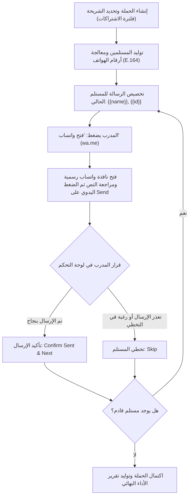

# دليل نظام الإشعارات الداخلية وحملات رسائل واتساب اليدوية (In-App Notifications & Manual WhatsApp Broadcast)

## 1. نظرة عامة على النظام (System Overview)
تم تصميم وتطوير هذه الوحدة في نظام إدارة جيم شلتوت (Shaltout Gym Management System) لتوفير منظومة اتصالات متكاملة ثنائية الأبعاد:
1. **مركز الإشعارات الداخلية (In-App Notification Center):** ربط تفاعلي فوري بين المدرب والمتدربين داخل لوحة التحكم، مع دعم جرس التنبيهات في الشريط العلوي (Header)، شارة العداد غير المقروء (Unread Badge)، التحديث الدوري (Polling)، وصفحة أرشيفية مخصصة ومفهرسة.
2. **مدير حملات واتساب اليدوي (Manual WhatsApp Broadcast Manager):** إدارة رسائل الجيم والحملات الدورية عبر روابط واتساب الرسمية (`wa.me`) بإرسال يدوي 100%، متوافق كلياً مع شروط وسياسات Meta / WhatsApp لمنع حظر الأرقام وبدون الحاجة إلى اشتراكات WhatsApp Cloud API المدفوعة أو أدوات الأتمتة غير الموثوقة.

---

## 2. مصفوفة أحداث النطاق والإشعارات الداخلية (Domain Events & Triggers Matrix)

| الحدث (Domain Event) | الفاعل (Actor) | المستلم (Recipient) | نوع الإشعار (`type`) | الأيقونة | الإجراء والرابط المرفق (`action_url`) |
| :--- | :--- | :--- | :--- | :--- | :--- |
| **تقديم طلب تعديل أوزان** | متدرب | المدرب (`user_type = 1`) | `coach_new_load_adjustment` | `ki-weight` | رابط مراجعة طلب تعديل الوزن |
| **مراجعة/اعتماد تعديل الأوزان** | المدرب | المتدرب المعني (`user_type = 2`) | `trainee_load_adjustment_reviewed` | `ki-check-circle` | صفحة الخطة التدريبية للمتدرب |
| **تحديث أو تعيين جدول تدريبي** | المدرب | المتدرب | `trainee_workout_updated` | `ki-abstract-26` | صفحة التمارين `system.dashboard.trainer` |
| **تحديث الخطة الغذائية** | المدرب | المتدرب | `trainee_nutrition_updated` | `ki-apple` | صفحة الخطة الغذائية `system.nutrition.my-plan` |
| **تسجيل قياسات وصور تقدم جديدة** | متدرب | المدرب | `coach_new_progress` | `ki-camera` | صفحة مراجعة التقدم ومعرض الصور للمتدرب |
| **إضافة ملاحظات وتوجيهات المدرب** | المدرب | المتدرب | `trainee_coach_notes_updated` | `ki-message-text` | صفحة التقدم الخاصة بالمتدرب |
| **قرب انتهاء الاشتراك (7 أيام)** | النظام | المتدرب | `trainee_subscription_expiring` | `ki-calendar-tick` | تنبيه التجديد والتواصل |

### مميزات مركز الإشعارات:
- **منع التكرار (Duplicate Prevention):** منع توليد إشعارات مطابقة غير مقروءة لنفس المستخدم خلال ساعة واحدة.
- **عزل الصلاحيات:** عزل كامل بين إشعارات المدربين وإشعارات المتدربين؛ لا يمكن لأي مستخدم الاطلاع على إشعارات غيره أو تغيير حالتها.
- **تحديث هيدر فوري (Dropdown API):** استهلاك نقطة `system/notifications/dropdown` بشكل خفيف كل دقيقة مع دعم تمييز المقروء فردياً أو جماعياً.

---

## 3. تدفق حملات رسائل واتساب اليدوية (Manual WhatsApp Broadcast Workflow)

### فلسفة الأمان والامتثال (Compliance & Safety First)
- **لا وجود للإرسال الآلي:** النظام لا يستخدم روبوتات ويب، أو برمجيات متصفح خفية (Puppeteer/Selenium)، أو WhatsApp Web Automation، أو WhatsApp Cloud API.
- **التشغيل الفردي المتعاقب (Sequential Step-by-Step):** المدرب يراجع كل متدرب على حدة.
- **رابط `wa.me` الرسمي:** فتح محادثة المتدرب عبر بروتوكول واتساب المعتمد مع النص المشفر مسبقاً وفق معيار RFC 3986.
- **المدرب هو صاحب قرار الإرسال:** المدرب يضغط "Send" بنفسه داخل تطبيق واتساب، ثم يعود للشاشة ليؤكد الإرسال يدوياً ("Confirm Sent & Next") أو يتجاوز المتدرب ("Skip").

---

## 4. التغييرات في قاعدة البيانات (Database Schema Changes)

تم إنشاء ملف الهجرة `database/migrations/2026_11_02_000001_create_notifications_and_whatsapp_tables.php` الذي يتضمن:

1. **جدول `notifications`:**
   - `id`: المعرف الأساسي.
   - `user_id`: معرّف المستخدم (مطابق لنوع `user.id` وهو `int(11)`).
   - `type`: نوع الإشعار النطاقي (varchar).
   - `title`: عنوان الإشعار.
   - `message`: نص الإشعار.
   - `action_url`: رابط الإجراء المباشر (nullable).
   - `icon`: اسم أيقونة KeenIcons (nullable).
   - `read_at`: تاريخ ووقت القراءة (null = غير مقروء).
   - الفهارس: فهارس مركبة على `(user_id, read_at)` و `(user_id, created_at)` لأداء فائق.

2. **حقل `whatsapp_opt_out` في جدول `trainees`:**
   - حقل منطقي `boolean` بقيمة افتراضية `false`. يسمح للمتدربين بطلب عدم استلام رسائل واتساب الجماعية.

3. **جدول `whatsapp_campaigns`:**
   - `id`: المعرف الأساسي.
   - `coach_id`: معرف المدرب منشئ الحملة (`int(11)` مرجعي لـ `user.id`).
   - `title`: عنوان الحملة.
   - `message_template`: قالب الرسالة المحتوي على المتغيرات.
   - `total_recipients`: إجمالي المستهدفين المؤهلين.
   - `opened_count`, `confirmed_count`, `skipped_count`: عدادات حالة التنفيذ.
   - `status`: حالة الحملة (`draft`, `in_progress`, `completed`, `cancelled`).
   - `started_at`, `completed_at`: أختام زمنية.

4. **جدول `whatsapp_campaign_recipients`:**
   - `id`: المعرف الأساسي.
   - `campaign_id`: معرف الحملة (مرجعي).
   - `trainee_id`: معرف المتدرب (`bigint unsigned`).
   - `recipient_name`: اسم المتدرب وقت إطلاق الحملة.
   - `phone_raw`: رقم الهاتف الأصلي المسجل.
   - `phone_normalized`: الرقم المعالج وفق صيغة E.164 الدولية.
   - `message_rendered`: نص الرسالة المخصصة بعد استبدال المتغيرات.
   - `status`: حالة الإرسال (`pending`, `opened`, `confirmed`, `skipped`).
   - `opened_at`: توقيت فتح رابط واتساب.
   - `confirmed_at`: توقيت تأكيد الإرسال من قبل المدرب.
   - `notes`: ملاحظات الاستبعاد أو سبب التخطي.

---

## 5. قواعد معالجة وتوحيد أرقام الهواتف (Phone Normalization Rules)

تتعامل خدمة `WhatsAppBroadcastService::normalizePhoneNumber()` بذكاء ودقة مع مختلف صيغ كتابة الأرقام:
1. **الأرقام المصرية المحلية (11 رقماً تبدأ بصفر):**
   - مثل `01012345678` أو `011...` أو `012...` أو `015...` -> يتم حذف الصفر وإضافة كود الدولة `20`: النتيجة `201012345678`.
2. **الأرقام المصرية بدون صفر البداية (10 أرقام):**
   - مثل `1012345678` -> تصبح `201012345678`.
3. **الأرقام بالبادئة الدولية الكاملة:**
   - مثل `+201012345678` أو `00201012345678` -> تصبح `201012345678`.
4. **الأرقام الدولية (الخليج والعالم):**
   - مثل `+966501234567` أو `00966501234567` -> تصبح `966501234567`.
5. **الاستبعاد للأرقام الخاطئة:**
   - الأرقام الأقل من 10 أرقام أو التي تحتوي حروفاً أو الفارغة تُرفض فوراً وتصنف ضمن قائمة الاستبعاد مع توضيح السبب بدقة للمدرب ("رقم الهاتف مفقود أو غير صالح").

---

## 6. الصلاحيات وتأمين المسارات (Authorization & Protection)
- مسارات حملات واتساب محصورة حصرياً بالمدربين والإدارة (`user_type == 1`).
- مسارات المتدربين (`user_type == 2`) تمت حمايتها بفلترة مزدوجة في `Permission.php` وداخل الـ Controller عبر `authorizeCoach()` مما يمنع المتدرب من دخول أي مسار إرسال أو مراجعة حملات.
- مسارات الإشعارات متاحة لجميع المستخدمين المسجلين، مع عزل صارم لسجلات كل مستخدم على حدة.

---

## 7. الاختبارات والتحقق (Feature Tests Verification)
تمت كتابة اختبارات شاملة تغطي كافة متطلبات النظام بنسبة نجاح 100%:
- `tests/Feature/InAppNotificationTest.php`: اختبار إنشاء وتوصيل الإشعارات، العدادات، التمييز كمقروء، منع التكرار، وحماية الخصوصية بين المستخدمين (6 اختبارات).
- `tests/Feature/WhatsAppBroadcastTest.php`: اختبار توحيد أرقام الهواتف، معايير الترميز، استبدال المتغيرات، التدفق اليدوي المتعاقب للحملات، وحظر المتدربين من الوصول (5 اختبارات).
- إجمالي اختبارات النظام المجمعة مع المهام السابقة: **18 اختباراً بنجاح تام (101 تأكيد/Assertions)**.

