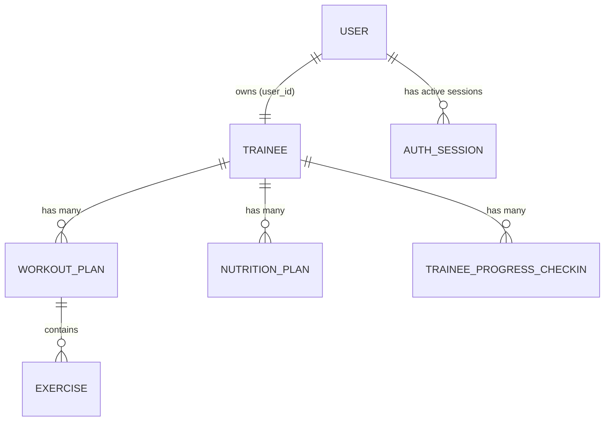

# توثيق وحدة إدارة المتدربين (Trainee Management System)

**المشروع:** نظام إدارة التدريب الرياضي كابتن محمود (Captain Mahmoud Fitness Management System)  
**المسار:** `docs/development/trainee-management.md`  
**تاريخ التوثيق:** أكتوبر 2026  
**نطاق العمل:** المهمة 3 — استقرار إدارة المتدربين واختبارات الانحدار (Trainee Management Stability & Regression Tests)

---

## 1. نظرة عامة والأهداف

تهدف هذه الوثيقة إلى توضيح المعمارية البرمجية، وقواعد العمل، والتحسينات الأمنية التي أُجريت على وحدة إدارة المتدربين (`Trainee Management`) في نظام Laravel الخاص بكابتن محمود. 

ركزت المعالجة على تحقيق استقرار تام وأمان عالي في العمليات التالية:
1. **اتساق وتوحيد معرفات المتدربين (Identifier Consistency):** دعم المعرفات المشفرة والرقمية بشكل متسق دون السماح بتداخل السجلات أو تعديل حسابات غير مقصودة.
2. **تحديث الملف الشخصي وحماية كلمات المرور (Profile Updates & Password Security):** التحقق من سلامة التحقق الميداني لقاعدة البيانات، والحفاظ على تجزئة كلمة المرور الحالية (`Password Hash`) عند التحديث دون تعديلها، وتشفير أي كلمة مرور جديدة بصورة آمنة.
3. **الحذف الآمن وتسلسل السجلات (Safe Soft Deletion):** تطبيق دالة الحذف `destroy` الناقصة في المتحكم والخدمة مع دعم الحذف الآمن (`SoftDeletes`) للمتدرب والمستخدم والخطط التابعة وتكامل الاستجابات مع واجهات الويب وطلبات AJAX.
4. **تغطية شاملة باختبارات الانحدار (Regression Test Coverage):** بناء فئة اختبارات مخصصة في بيئة معزولة بالكامل تغطي 13 سيناريو تشغيلي وأمني بدقة 100%.

---

## 2. المعمارية ونموذج البيانات (Data Architecture & Models)

### أ. العلاقة بين المستخدم (`User`) والمتدرب (`Trainee`)
يعتمد النظام على هيكل ثنائي لتمثيل المتدرب:
* **جدول `user` (النموذج `App\Models\User`):** يمثل كيان المصادقة والدخول للنظام (`Auth Entity`). يحتوي على بيانات الدخول: البريد الإلكتروني (`email`)، كلمة المرور المجزأة (`password`)، نوع المستخدم (`user_type`: القيمة `2` أو `3` للمتدربين)، ومجموعة الصلاحيات (`permission_group_id` = 125 للمتدربين).
* **جدول `trainees` (النموذج `App\Models\Trainee`):** يمثل السجل الرياضي والبيانات الفنية: الوزن (`weight`)، الطول (`height`)، العمر (`age`)، مستوى اللياقة (`training_level`)، وتواريخ بدء وانتهاء الاشتراك (`membership_start`, `membership_end`).

ترتبط العلاقة عبر المفتاح الأجنبي `trainees.user_id -> user.id`.



### ب. السجلات التابعة للكيان الرياضي
* **خطط التمرين (`workout_plans`):** تدعم الحذف الآمن (`SoftDeletes`) وترتبط بالتمارين (`exercises`).
* **خطط التغذية (`nutrition_plans`):** مرتبطة بسجل المتدرب.
* **تسجيلات المتابعة والتقدم (`trainee_progress_checkins`):** صور وقياسات الأوزان والملاحظات.
* **سجلات الجلسات النشطة (`auth_session`):** توكنات الدخول والأجهزة.

---

## 3. اتساق معالجة المعرفات (Trainee Identifier Consistency)

### المشكلة والسبب الجذري
في الواجهات السابقة، كانت بعض الروابط وجداول البيانات (`Datatables`) تمرر أحياناً المعرف المشفر (`Crypt::encrypt($trainee->id)`)، وأحياناً تمرر معرف المستخدم `user.id`، وأحياناً تمرر معرف المتدرب المباشر `trainee.id`. كان ذلك يؤدي إلى:
- تعذر فتح صفحة التعديل أو العرض إذا تم تمرير معرف المتدرب بدلاً من معرف المستخدم.
- أخطاء 500 في دوال `show` و `edit` عند فشل فك التشفير.
- مخاطرة في استعلامات التحديث (`update`) إذا استُخدم `user.id` بدلاً من `trainee.id`.

### الحل البرمجي المنفذ
تم استحداث دالة مساعدة مركزية في `app/Services/TraineeService.php`:
`resolveTraineeAndUser($id): array{0: ?Trainee, 1: ?User}`

```php
public function resolveTraineeAndUser($id): array
{
    if (empty($id)) {
        return [null, null];
    }

    // 1. فك التشفير في حال كان المعرف نصاً مشفراً
    if (is_string($id) && !ctype_digit($id)) {
        try {
            $id = Crypt::decrypt($id);
        } catch (\Exception $e) {
            // يبقى المعرف كما هو في حال لم يكن مشفراً
        }
    }

    // 2. محاولة مطابقة المعرف كـ Trainee ID
    $trainee = Trainee::find($id);
    if ($trainee) {
        $user = $trainee->user ?? User::find($trainee->user_id);
        return [$trainee, $user];
    }

    // 3. محاولة مطابقة المعرف كـ User ID للتوافق العكسي
    $user = User::find($id);
    if ($user) {
        $trainee = Trainee::where('user_id', $user->id)->first();
        return [$trainee, $user];
    }

    return [null, null];
}
```

تم توحيد استخدام هذه الدالة في كافة العمليات:
* `findById($id)`: لعرض صفحة تفاصيل المتدرب (`show`).
* `edit($id)`: لفتح صفحة تعديل المتدرب.
* `update($request, $id)`: لتطبيق التعديلات على السجل المطابق دون التباس.
* `destroy($id)`: لحذف المتدرب الصحيح وحسابه وسجلاته التابعة.

---

## 4. تحديث الملف الشخصي وحماية كلمات المرور (Profile Updates & Password Security)

### أ. قواعد التحقق وتفادي خطأ البريد المكرر
تم تحديث `app/Http/Requests/TraineeFormRequest.php` بحيث يتم استبانة معرف المستخدم الحقيقي وتمريره لقاعدة التجاهل `Rule::unique('user', 'email')->ignore($userId)`:

```php
$traineeParam = $this->route('trainee');
$userId = null;
if ($traineeParam) {
    [$traineeModel, $userModel] = app(TraineeService::class)->resolveTraineeAndUser($traineeParam);
    $userId = $userModel ? $userModel->id : null;
}

return [
    'name'     => 'required|string|max:191',
    'email'    => ['required', 'email', Rule::unique('user', 'email')->ignore($userId)],
    'password' => 'nullable|string|min:6',
    // ... بقية الحقول الرياضية
];
```

### ب. الحفاظ على تجزئة كلمة المرور والتشفير الآمن
في دالة `TraineeService@update`:
- إذا تُرك حقل `password` فارغاً في طلب التحديث، يتم استبعاده تماماً من مصفوفة التحديث لحفظ الـ Hash القائم دون استبداله أو إفساده.
- إذا قام المسؤول أو المدرب بإدخال كلمة مرور جديدة، يتم تشفيرها تلقائياً باستخدام دالة التجزئة الآمنة `Hash::make($request->password)`.
- لا يتم حفظ أو عرض أي كلمة مرور كنص صريح (`plain-text`) تحت أي ظرف.

### ج. عزل صلاحيات التعديل
في `app/Modules/System/TraineeController@update`:
- تم فرض تحقق يمنع أي متدرب (`user_type == 2, 3`) من تعديل أي حساب رياضي لا يملكه شخصياً (`abort(403)`).
- المدربون والمسؤولون (`user_type == 1` أو مستخدمو الإشراف) يملكون حق تحديث المتدربين المخصصين لهم وفق الصلاحيات الإدارية.

---

## 5. الحذف الآمن للمتدربين (Trainee Deletion Workflow)

### أ. مسار ودالة الحذف
مسار الحذف مسجل كجزء من المورد:
`DELETE /system/trainee/{trainee}` باسم المسار `system.trainee.destroy`.

تمت إضافة إذن الحذف في مصفوفة الصلاحيات `app/Modules/System/Permissions.php`:
```php
'delete-trainee' => [
    'system.trainee.destroy'
],
```

### ب. تنفيذ الدالة في المتحكم (`TraineeController@destroy`)
- التحقق من صلاحيات المستخدم ومنع المتدربين من الحذف (`403 Forbidden`).
- استبانة المتدرب وإرجاع `404 Not Found` أو رسالة خطأ مناسبة عند عدم وجود السجل.
- استدعاء `TraineeService::destroy($id)`.
- دعم الاستجابة التلقائية المزدوجة:
  - استجابة JSON للطلبات القادمة عبر AJAX و Datatables.
  - إعادة توجيه (`Redirect`) إلى `system.trainee.index` مع رسائل التنبيه للمتصفح العادي.

### ج. التسلسل الآمن للحذف في طبقة الخدمة (`TraineeService@destroy`)
تتم العملية بالكامل داخل معاملة قاعدة بيانات (`DB::transaction`):
1. حذف سجل المتدرب ناعماً (`$trainee->delete()`)، مما يُفعل حدث الإلغاء في نموذج `Trainee` لحذف خطط التمرين وخطط التغذية المرتبطة.
2. حذف حساب المستخدم المرتبط ناعماً (`$user->delete()`) لتعطيل إمكانية تسجيل الدخول فوراً.
3. تفادي حذف ملفات الصور أو الموارد الثابتة بشكل متهور بدون قرار إداري مقصود.

---

## 6. تغطية اختبارات الانحدار (Regression Testing Coverage)

تم إنشاء ملف اختبارات مخصص ومتكامل في:
`tests/Feature/TraineeManagementTest.php`

يعمل الاختبار داخل بيئة SQLite معزولة في الذاكرة (`:memory:`) متوافقاً مع قواعد العزل الصارمة للتطبيق.

### السيناريوهات الـ 13 المغطاة في الاختبار:

| # | السيناريو | دالة الاختبار | النتيجة |
|---|---|---|---|
| 1 | عرض المتدرب باستخدام معرفات صالحة (Trainee ID, User ID, Encrypted ID) | `test_view_trainee_using_valid_identifiers` | **ناجح (PASSED)** |
| 2 | فتح صفحة تعديل المتدرب الصحيح والتأكد من تمرير البيانات للواجهة | `test_open_correct_trainee_edit_page` | **ناجح (PASSED)** |
| 3 | تحديث المتدرب المقصود دون التأثير على أي سجل متدرب آخر | `test_update_intended_trainee_without_affecting_another_record` | **ناجح (PASSED)** |
| 4 | التعامل السليم مع المعرفات غير الصالحة أو السجلات غير الموجودة (404) | `test_handle_invalid_or_nonexistent_identifiers` | **ناجح (PASSED)** |
| 5 | رفض محاولات التحديث غير المصرح بها ومنع المتدربين من تعديل غيرهم (403) | `test_reject_unauthorized_profile_updates` | **ناجح (PASSED)** |
| 6 | السماح بحذف المتدرب للمستخدمين المصرح لهم (Admin/Coach) | `test_allow_authorized_trainee_deletion` | **ناجح (PASSED)** |
| 7 | رفض محاولات الحذف غير المصرح بها (المتدربون والضيوف) | `test_reject_unauthorized_trainee_deletion` | **ناجح (PASSED)** |
| 8 | التعامل السليم مع حذف السجلات غير الموجودة | `test_handle_deletion_of_nonexistent_records` | **ناجح (PASSED)** |
| 9 | الحفاظ على تجزئة كلمة المرور الحالية عند تحديث بيانات الملف الشخصي | `test_preserve_current_password_when_updating_profile_without_password` | **ناجح (PASSED)** |
| 10 | تشفير وتجزئة كلمة المرور الجديدة عند تزويدها في التحديث | `test_correctly_hash_newly_supplied_password` | **ناجح (PASSED)** |
| 11 | الحفاظ على سلوك الحذف الآمن (`SoftDeletes`) والعلاقات المتسلسلة | `test_preserve_soft_delete_cascades_for_trainee_relations` | **ناجح (PASSED)** |
| 12 | الحفاظ على تدفقات العمل المشروعة للمدربين والمسؤولين (قائمة، إنشاء، انتحال صفة) | `test_maintain_legitimate_coach_and_admin_workflows` | **ناجح (PASSED)** |
| 13 | الحفاظ على حماية الصلاحيات الأمنية المطبقة في المهمة السابقة (Task 2) | `test_preserve_task_2_authorization_protections` | **ناجح (PASSED)** |

### ملخص نتائج تشغيل الاختبارات:
* **الأمر:** `php vendor/phpunit/phpunit/phpunit tests/Feature/TraineeManagementTest.php`
* **النتيجة:** `13 / 13 (100%)`
* **عدد التأكيدات (Assertions):** `72 assertions`
* **الإخفاقات:** `0 Failures`

كما تم تشغيل كامل طاقم الاختبارات للنظام:
* **الأمر:** `php vendor/phpunit/phpunit/phpunit`
* **النتيجة:** `34 / 34 (100%)`
* **عدد التأكيدات (Assertions):** `164 assertions`
* **الإخفاقات:** `0 Failures`

---

## 7. سلامة البيئة التشغيلية (Safety & Production Integrity)

- لم يتم الاتصال أو التعديل بأي شكل على قاعدة بيانات الإنتاج أو ملفات `.env`.
- تمت جميع التعديلات محلياً فقط على فرع العمل `refactor-project`.
- لم يتم استخدام أي أوامر مدمرة مثل `migrate:fresh` أو `db:wipe` على أي قاعدة بيانات حقيقية.
- تم الحفاظ على كافة التعديلات البرمجية السابقة الخاصة بالمهمتين 1 و 2 دون أي إفساد أو تعارض.
